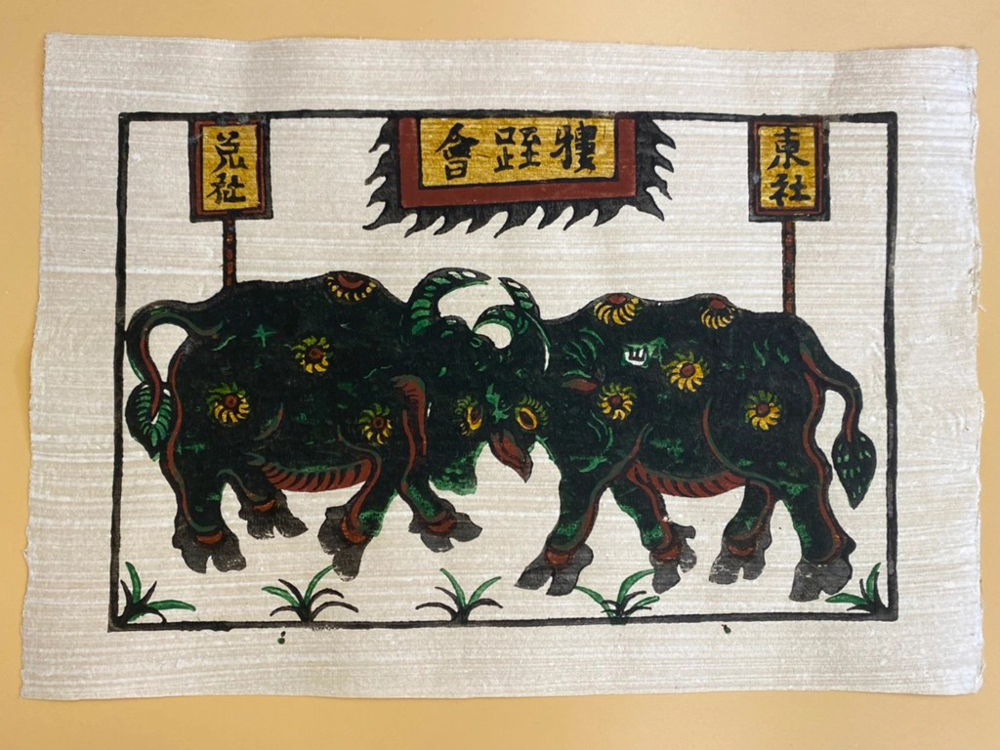
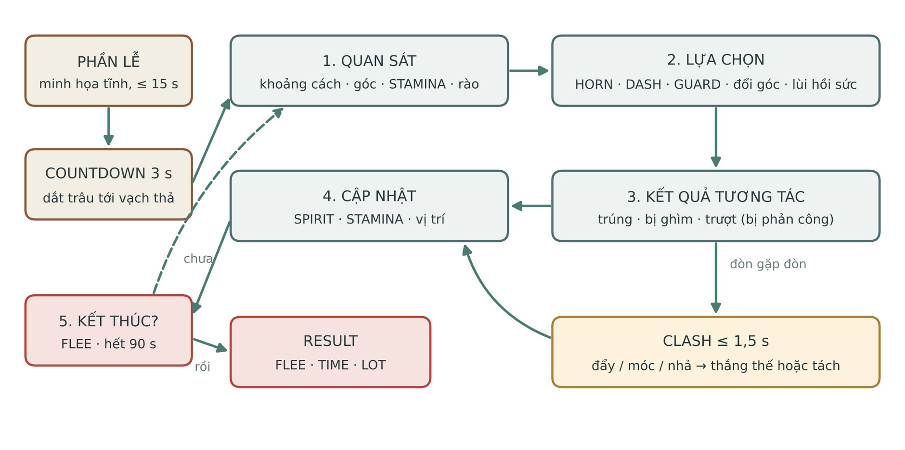
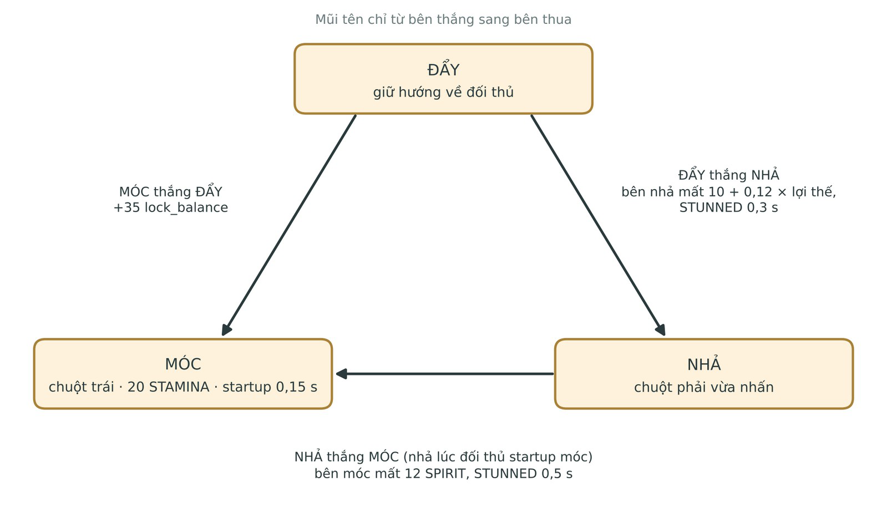
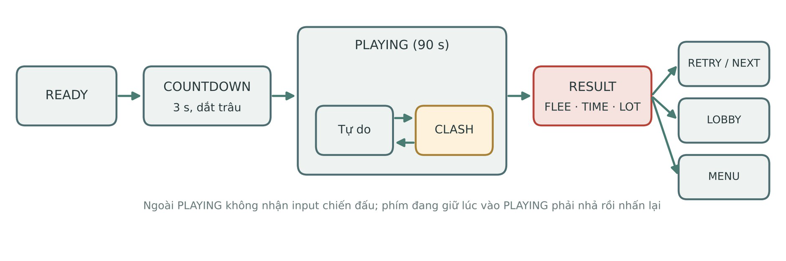
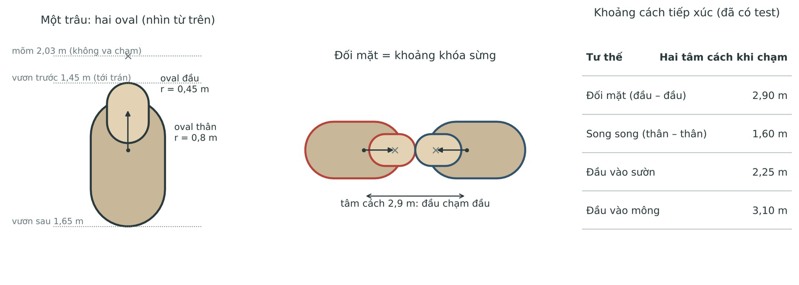
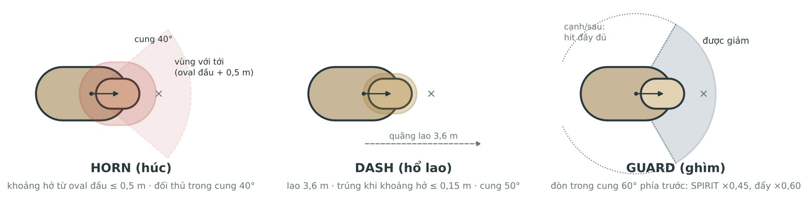
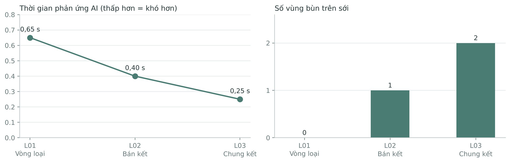
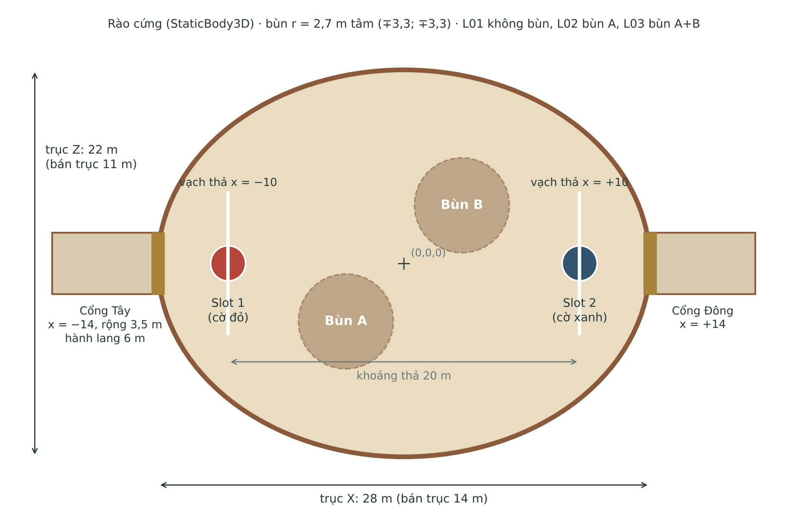
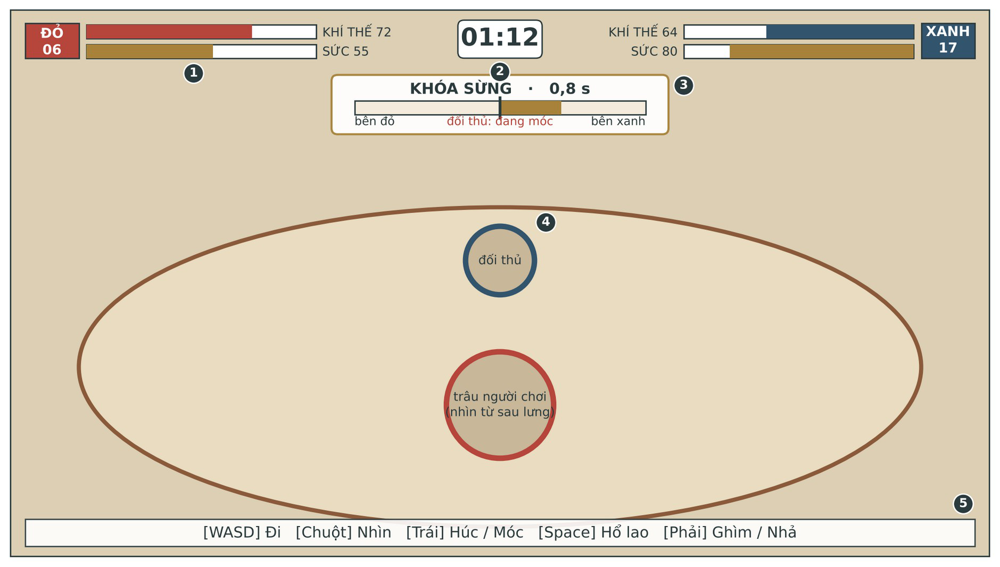
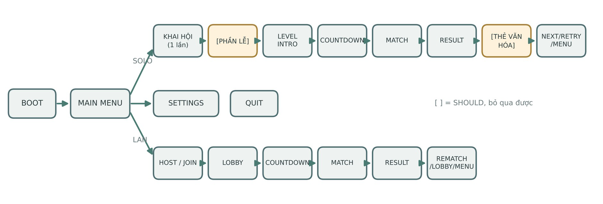

# Chọi Trâu: Đấu Trường Lễ Hội — GDD v0.7

> Bản chuyển đổi đối chiếu PDF 42 trang; giữ nguyên nội dung thiết kế. Các bảng nối trang được giữ tách theo trang để không suy diễn ô còn thiếu. Hình gốc được nhúng ở đúng vị trí; mỗi trang có liên kết ảnh toàn trang. Các dòng chữ trong ảnh chưa được OCR thành văn bản.

[PDF nguồn](GDD_Choi_Trau_v0.7.pdf) · [Biên bản kiểm tra](GDD_Choi_Trau_v0.7_conversion_review.md)

## Tra cứu theo trang

[Trang 1](#trang-01) · [Trang 2](#trang-02) · [Trang 3](#trang-03) · [Trang 4](#trang-04) · [Trang 5](#trang-05) · [Trang 6](#trang-06) · [Trang 7](#trang-07) · [Trang 8](#trang-08) · [Trang 9](#trang-09) · [Trang 10](#trang-10) · [Trang 11](#trang-11) · [Trang 12](#trang-12) · [Trang 13](#trang-13) · [Trang 14](#trang-14) · [Trang 15](#trang-15) · [Trang 16](#trang-16) · [Trang 17](#trang-17) · [Trang 18](#trang-18) · [Trang 19](#trang-19) · [Trang 20](#trang-20) · [Trang 21](#trang-21) · [Trang 22](#trang-22) · [Trang 23](#trang-23) · [Trang 24](#trang-24) · [Trang 25](#trang-25) · [Trang 26](#trang-26) · [Trang 27](#trang-27) · [Trang 28](#trang-28) · [Trang 29](#trang-29) · [Trang 30](#trang-30) · [Trang 31](#trang-31) · [Trang 32](#trang-32) · [Trang 33](#trang-33) · [Trang 34](#trang-34) · [Trang 35](#trang-35) · [Trang 36](#trang-36) · [Trang 37](#trang-37) · [Trang 38](#trang-38) · [Trang 39](#trang-39) · [Trang 40](#trang-40) · [Trang 41](#trang-41) · [Trang 42](#trang-42)

## Trang 01

[Xem ảnh trang PDF gốc](GDD_Choi_Trau_v0.7_assets/page-01.png)

GAME DESIGN DOCUMENT
CHỌI TRÂU: ĐẤU TRƯỜNG LỄ HỘI
Phiên bản 0.7 — 01/11/2026
Mục lục
0. Kiểm soát tài liệu........................................................................................................3
1. Tổng quan...................................................................................................................6
1.1 Điểm khác biệt (USP)...........................................................................................6
1.2 Design pillars và non-goals..................................................................................6
1.3 Game tham chiếu và phân tích.............................................................................7
2. Gameplay cốt lõi.........................................................................................................8
2.1 Điều khiển............................................................................................................8
2.2 Giải quyết hành động đồng thời...........................................................................9
2.3 Bảng tương tác...................................................................................................10
2.4 Khóa sừng (CLASH)..........................................................................................10
2.5 Thắng, thua và kết thúc trận...............................................................................12
2.6 Trạng thái trận....................................................................................................13
2.7 Chế độ chơi.........................................................................................................13
3. Hệ thống....................................................................................................................14
3.1 Di chuyển và vật lý.............................................................................................14
3.2 Tài nguyên trong trận: SPIRIT và STAMINA...................................................15
3.3 Combat...............................................................................................................16
3.4 Cân bằng.............................................................................................................16
3.5 AI — Finite State Machine................................................................................17
3.6 Network — ENet LAN 1v1................................................................................18
3.7 Tiến trình và đường cong độ khó.......................................................................18
4. Màn chơi, nội dung và thế giới.................................................................................20
4.1 Sới chọi...............................................................................................................20
4.2 Ba trận Solo và cách giới thiệu cơ chế...............................................................20
4.3 Nhịp độ (pacing).................................................................................................21
4.4 Danh sách nội dung MVP..................................................................................21
4.5 Bối cảnh, nhân vật và cách kể chuyện................................................................21

## Trang 02

[Xem ảnh trang PDF gốc](GDD_Choi_Trau_v0.7_assets/page-02.png)

4.6 Nguyên tắc nội dung (bắt buộc).........................................................................22
5. Art, audio và UI/UX.................................................................................................23
5.1 Style guide..........................................................................................................23
5.2 HUD...................................................................................................................23
5.3 Luồng màn hình và menu...................................................................................24
5.4 Phản hồi va chạm (game feel)............................................................................24
5.5 Âm thanh và nhạc...............................................................................................24
5.6 Danh sách asset..................................................................................................25
6. Kỹ thuật và sản xuất.................................................................................................26
6.1 Engine và lý do chọn..........................................................................................26
6.2 Kiến trúc và các hệ thống...................................................................................26
6.3 Phạm vi MVP.....................................................................................................26
6.4 Mốc tiến độ.........................................................................................................27
6.5 Rủi ro..................................................................................................................27
6.6 Playtest và câu hỏi cần trả lời.............................................................................28
6.7 Chất lượng, build và tài liệu...............................................................................29
7. Định vị và phát hành.................................................................................................30
Phụ lục A — Cơ sở thiết kế..........................................................................................31
A.0 Quyết định nền tảng...........................................................................................31
A.1 Vì sao thắng bằng SPIRIT thay vì HP...............................................................31
A.2 Luật chơi............................................................................................................31
A.3 Combat và số liệu..............................................................................................32
A.4 AI và network....................................................................................................32
A.5 Sới và màn chơi.................................................................................................33
A.6 Văn hóa và nguyên tắc nội dung.......................................................................33
A.7 Tổng hợp điểm game hóa so với thực tế...........................................................34
A.8 Hình va chạm hai oval.......................................................................................34
Phụ lục B — Nguồn......................................................................................................35
Phụ lục C — Số liệu cân bằng và yêu cầu....................................................................37
Phụ lục D — Ý tưởng sau MVP (OUT).......................................................................40
Phụ lục E — Lịch sử thay đổi.......................................................................................41

## Trang 03

[Xem ảnh trang PDF gốc](GDD_Choi_Trau_v0.7_assets/page-03.png)

### 0. Kiểm soát tài liệu
Quy ước. MUST = bắt buộc trong MVP và sẽ được nghiệm thu ở Assignment 02;
SHOULD = làm nếu còn thời gian; OUT = không làm trong MVP. Mỗi yêu cầu triển
khai có mã REQ-…, người phụ trách và tiêu chí nghiệm thu (Phụ lục C). Thân tài liệu
mô tả làm gì; lý do và phương án đã cân nhắc nằm ở Phụ lục A, nguồn ở Phụ lục B,
lịch sử thay đổi ở Phụ lục E. Mọi giá trị số đã chạy trong prototype (Godot 4.7.2) và
có test tự động; chưa playtest với người ngoài nhóm nên vẫn là baseline cân bằng.
**Bảng 1. Thuật ngữ chính thức — mỗi khái niệm chỉ dùng một tên**

| Tên trong code / GDD | Tên trên UI | Ý nghĩa | Không dùng |
| --- | --- | --- | --- |
| SPIRIT | Khí thế | Ý chí chiến đấu; về 0 thì trâu chịu thua | máu, HP, Spirit |
| STAMINA | Sức | Tài nguyên tiêu cho mọi hành động | Thể lực/Stamina lẫn lộn |
| HORN | Húc | Đòn cận chiến cơ bản (chuột trái) | — |
| DASH | Hổ lao | Lao có quán tính (Space) | Hồ lao, Dash |
| GUARD | Ghìm | Giảm SPIRIT mất với đòn phía trước (giữ chuột phải) | đỡ, giơ càng |
| CLASH | Khóa sừng | Giằng co ≤ 1,5 s khi đòn gặp đòn đang ra | Clash, Oẳn tù tì |
| PUSH / HOOK / RELEASE | Đẩy / Móc / Nhả | Ba lựa chọn trong CLASH | — |
| lock_balance | Thanh KHÓA SỪNG | Thanh giằng co −100…+100; dương = slot 1 có lợi | balance |
| PINNED | Bị dồn rào | Điều kiện xét lúc trúng đòn: sát rào, bị đẩy ra rào | trạng thái PINNED |
| FLEE / TIME / LOT | Chịu thua / Hết giờ / Bốc thăm | Ba kiểu kết thúc trận | hòa, đo ván, lủi sới |
| host | Chủ phòng | Máy giữ nguồn sự thật trong LAN | server, máy chủ |

**Bảng 2. Phân vai trong nhóm**

| Vai | Phụ trách | Thư mục chính |
| --- | --- | --- |
| A — Core gameplay | Di chuyển, vật lý, camera, combat, CLASH, luật trận, data/balance.json | scripts/core/, scripts/follow_camera.gd |
| B — AI &amp; Network | FSM AI, 3 profile, ENet LAN, đồng bộ snapshot | scripts/ai/, scripts/network/ |
| C — Nội dung &amp; trình bày | UI/HUD, màn chơi, Phần Lễ, art, audio, data/levels.json | scripts/ui/, assets/ |

Quy tắc chống mâu thuẫn. Mọi hằng số gameplay chỉ khai báo trong
data/balance.json. UI, AI và Network không ghi trực tiếp SPIRIT hay vị trí trâu;
chỉ gửi input qua contract tích hợp (TDD). Mỗi thay đổi luật phải cập nhật cùng lúc
GDD, config, test và changelog trong một PR, kèm Decision ID; lịch sử thay đổi phía
code ghi ở docs/CHANGELOG_GDD.md. Ngoại lệ: hằng số thuật toán (sai số, số
lượt giải va chạm) được viết trong code.

## Trang 04

[Xem ảnh trang PDF gốc](GDD_Choi_Trau_v0.7_assets/page-04.png)

**Bảng 3. Bốn ràng buộc của đề bài và nơi đáp ứng**

| Ràng buộc | Đáp ứng ở | Tóm tắt |
| --- | --- | --- |
| Thiết kế vật lý | Mục 2.2, 3.1, 3.3 | Jolt Physics; CharacterBody3D hình hai oval va chạm rào; tách hai trâu, tính hit và PINNED do nhóm tự viết trên mặt phẳng XZ; ghi đè vận tốc; giải quyết đồng thời 60 Hz |
| Network | Mục 3.6 | ENet LAN 1v1, host-authoritative, snapshot 30 Hz, đồng bộ cả trạng thái CLASH |
| AI | Mục 3.5 | FSM 3 profile, AI chỉ tạo InputFrame như người chơi |
| Modern Game Engine | Mục 6.1 | Godot 4.7.2, GDScript, GL Compatibility; mô hình trâu Blender → glTF, sân dựng bằng code |

**Bảng 4. Decision log**

| ID | Quyết định | Cơ sở | Trạng thái |
| --- | --- | --- | --- |
| DEC-01 | 3D low-poly, góc nhìn thứ ba thấp qua vai phải (nghiêng 22°, sửa ở v0.7.1); chuột xoay hướng nhìn; gameplay trên mặt phẳng XZ | PL A.0 | Accepted |
| DEC-02 | Godot 4.7.2 (GL Compatibility, Jolt Physics), GDScript, Windows | PL A.0 | Accepted |
| DEC-03 | Một sới, ba cấu hình trận PvE + LAN 1v1 | PL A.0 | Accepted |
| DEC-04 | Host-authoritative, chỉ LAN trực tiếp | PL A.0 | Accepted |
| DEC-05 | Không gore; trâu và nhân vật cách điệu | PL A.0, A.6 | Accepted |
| DEC-06 | Thắng khi đối phương chịu thua: SPIRIT về 0 → FLEE (không dùng HP) | PL A.1 | Accepted |
| DEC-07 | Hết giờ: SPIRIT cao hơn thắng TIME; bằng nhau hoặc cùng về 0 → LOT; không có hòa | PL A.2 | Accepted |
| DEC-08 | Giải quyết đồng thời, đối xứng; đòn gặp đòn đang ra → CLASH với ba lựa chọn đẩy / móc / nhả | PL A.2 | Proposed: chờ playtest độ dễ hiểu |
| DEC-09 | Sới bầu dục có rào, 2 cổng Đông/Tây; PINNED thay RING_OUT | PL A.3, A.5 | Accepted |
| DEC-10 | Nhận diện trâu bằng số hiệu + cờ giáp | PL A.6 | Accepted |
| DEC-11 | Có Phần Lễ + nguyên tắc tôn trọng thuần phong mỹ tục | PL A.6 | Accepted |
| DEC-12 | Tắt hồi SPIRIT trong MVP | PL A.3 | Accepted |
| DEC-13 | WASD di chuyển, chuột nhìn, chuột trái húc, chuột phải ghìm, Space hổ lao | PL A.0 | Accepted |
| DEC-14 | Hình va chạm của trâu gồm hai oval (thân và đầu, đầu dừng ở trán); tầm đánh đo bằng khoảng hở từ oval đầu; khóa sừng ở 2,9 m | PL A.8 | Accepted |
| DEC-15 | AI giữ khoảng hở 0,1–0,5 m, RECOVER khi STAMINA &lt; 25 tới &gt; 60, né dọc rào; chỉ ra đòn khi đủ STAMINA, hết cooldown, đối thủ ở phía trước | PL A.4 | Accepted |
| DEC-16 | Hết trận chỉ đóng băng hai trâu; cảnh trâu thua lui ra cổng là SHOULD | PL A.2 | Accepted |

## Trang 05

[Xem ảnh trang PDF gốc](GDD_Choi_Trau_v0.7_assets/page-05.png)

Accepted = đã hiện thực trong prototype và có test tự động (DEC-05, DEC-11 là
quyết định nội dung). Proposed = còn chờ playtest với người chơi. Mọi thay đổi ghi
vào Phụ lục E.

## Trang 06

[Xem ảnh trang PDF gốc](GDD_Choi_Trau_v0.7_assets/page-06.png)

### 1. Tổng quan
Chọi Trâu: Đấu Trường Lễ Hội là game đối kháng 3D low-poly cách điệu cho PC
(Windows), đặt trong hội chọi trâu của một làng biển Bắc Bộ hư cấu, nơi người chơi
bẻ khí thế ông trâu đối phương bằng húc, hổ lao và khóa sừng, chơi solo với AI hoặc
LAN 1v1.
Trống hội nổi ba hồi. Loa gọi ông trâu số 06 giáp Đông và ông trâu số 17 giáp Tây.
Người dắt tháo thừng ở vạch thả, hai trâu cách nhau 20 m. Từ đây người chơi điều
khiển trâu của mình: giữ sừng hướng về đối thủ, đi vòng tìm sườn, dồn đối phương về
phía rào, và giữ sức cho lúc khóa sừng. Trâu nào hết khí thế sẽ quay đầu lui sới.
**Bảng 5. Thông tin cơ bản**

| Mục | Nội dung |
| --- | --- |
| Thể loại | Arena combat / action versus 1v1, góc nhìn thứ ba thấp qua vai (nghiêng 22°) |
| Nền tảng &amp; input | Windows, bàn phím + chuột; LAN cho 2 máy; thiết kế ở 1280×720, 16:9 |
| Người chơi mục tiêu | 12+, thích trận ngắn dễ học nhưng có kỹ năng căn góc và quản lý STAMINA; người quan tâm văn hóa lễ hội |
| Player fantasy | Chủ trâu của một giáp, dắt ông trâu qua vòng loại, bán kết, chung kết của mùa hội |
| Độ dài | Một trận ≤ 90 s; một lượt Solo khoảng 5–10 phút |

#### 1.1 Điểm khác biệt (USP)
### 1. Giao tranh phụ thuộc góc và vị trí. Đi vòng ra cạnh hoặc sau, dồn đối thủ vào
rào; bấm nút liên tục không thắng được.
### 2. Thắng bằng bẻ khí thế, không trừ máu. Vòng húc – ghìm – khóa sừng – lùi
hồi sức, kết thúc khi đối phương chịu thua.
### 3. Cùng một luật cho PvE và PvP, và mùa hội có Phần Lễ giới thiệu nghi lễ
truyền thống một cách trang trọng.
#### 1.2 Design pillars và non-goals
- P1 – Nhìn là hiểu va chạm: góc, khoảng cách và kết quả đòn phải đọc được
ngay.
- P2 – Input phản hồi nhanh: buffer 0,10 s, không có độ trễ cảm nhận được ở
local.
- P3 – Trận ≤ 90 giây.
- P4 – Cùng một luật cho PvE và PvP; AI là một nguồn input như người chơi.
- P5 – Bám luật lễ hội thật, trình bày nghi lễ trang trọng.
Non-goals: matchmaking qua Internet, tài khoản, cửa hàng, nâng cấp, nhiều giống
trâu, mô phỏng sinh học thật, máu me, ragdoll, cá cược, minh họa nghi thức hiến sinh.

## Trang 07

[Xem ảnh trang PDF gốc](GDD_Choi_Trau_v0.7_assets/page-07.png)

**Hình 1. Tranh dân gian Đông Hồ “Chọi trâu”**
#### 1.3 Game tham chiếu và phân tích
**Bảng 6. Học gì từ các game tham chiếu**

| Game | Điều lấy | Điều không lấy | Vì sao |
| --- | --- | --- | --- |
| Nidhogg | Đấu tay đôi ngắn, áp lực vị trí, vòng thử lại nhanh | Đổi màn theo hướng chạy, chết tức thì | Trận chọi trâu kết thúc bằng chịu thua, không phải một đòn |
| Rocket League | Hướng tiếp cận và đà quyết định va chạm | Vật lý tự do, nhảy, xoay trên không | Giữ vật lý đơn giản để host tính một kết quả duy nhất |
| For Honor | Góc nhìn thứ ba bám lưng, thanh stamina, phòng thủ theo hướng, thưởng khi dồn đối thủ vào tường | Ba hướng guard, combo dài, guard break | GUARD chỉ còn một cung trước 60° cho dễ đọc; PINNED thay đẩy vào tường |
| Sekiro (hệ thống posture) | Thanh đo áp lực tinh thần thay vì máu | Đòn kết liễu | SPIRIT về 0 là chịu thua, đúng luật lễ hội |

Game này chủ động đơn giản hóa điều khiển và vật lý so với các tham chiếu để vừa
phạm vi nhóm 3 người.

## Trang 08

[Xem ảnh trang PDF gốc](GDD_Choi_Trau_v0.7_assets/page-08.png)

### 2. Gameplay cốt lõi
Mỗi trận là một vòng quan sát – lựa chọn – tương tác – cập nhật, lặp lại cho đến khi
một trâu chịu thua hoặc hết 90 giây. Phần Lễ và cảnh dắt trâu nằm trước vòng lặp,
không nằm trong nó.

**Hình 2. Core loop của một trận**
#### 2.1 Điều khiển
**Bảng 7. Input map**

| Hành động | Phím | Điều kiện |
| --- | --- | --- |
| LOOK | Chuột | Xoay camera quanh trâu (nghiêng cố định 22°, lệch qua vai phải). Thân trâu xoay theo, tối đa turn_rate_deg_s |
| MOVE | W/A/S/D | Theo hướng camera: W tiến, A/D đi ngang ×0,7, S lùi ×0,5. Trong CLASH: giữ hướng về đối thủ = đẩy |
| HORN (húc) | Chuột trái | Không STUNNED, không GUARD, không đang action khác; đủ 20 STAMINA; hết cooldown. Trong CLASH: móc |
| DASH (hổ lao) | Space | Như HORN; đủ 28 STAMINA. Không dùng trong CLASH |
| GUARD (ghìm) | Chuột phải (giữ) | Bắt đầu khi STAMINA ≥ 10; không bắt đầu khi đang action. Trong CLASH: chuột phải vừa nhấn xuống = nhả |
| PAUSE | Esc | PvE: dừng thời gian. PvP: gửi yêu cầu, chỉ dừng khi đối phương đồng ý |
| CONFIRM / BACK | Enter / Esc | Menu (chuột dùng được trong menu) |

Ưu tiên input trong cùng một tick
### 1. Đang STUNNED hoặc FLEE: mọi input chiến đấu bị bỏ qua, không buffer.
### 2. GUARD đang giữ thì chặn HORN/DASH. Nhấn HORN và DASH cùng tick →
HORN thắng, chỉ trừ 20 STAMINA. Trong CLASH, móc và nhả cùng tick →
nhả thắng.

## Trang 09

[Xem ảnh trang PDF gốc](GDD_Choi_Trau_v0.7_assets/page-09.png)

### 3. HORN/DASH bấm khi chưa hết cooldown/recovery được giữ trong 0,10 s
(input_buffer_s); quá hạn thì hủy; không xếp hàng nhiều action.
### 4. Cooldown tính từ lúc bắt đầu action; chi phí STAMINA trừ ngay lúc bắt đầu,
trước khi tính hồi STAMINA của tick đó.
**Bảng 8. Quyền điều khiển theo trạng thái**

| Trạng thái | Di chuyển (WASD) | Xoay thân | Action mới / GUARD |
| --- | --- | --- | --- |
| Bình thường | 100% × hệ số hướng | Theo camera, tối đa turn_rate | Được |
| GUARD | × 0,55 | Theo camera | Không ra HORN/DASH |
| HORN startup + active | × 0,30 | Khóa | Không (được buffer) |
| HORN recovery (0,20 s) | × 0,50 | Theo camera | Không (được buffer) |
| DASH active (0,22 s) | Bỏ qua; vận tốc = dash_speed theo hướng mặt | Khóa | Không |
| DASH recovery (0,25 s) | Bỏ qua; giảm tốc về 0 | Theo camera | Không (được buffer) |
| STUNNED | Bỏ qua; vận tốc = knockback, giảm dần | Khóa | Không, không buffer |
| CLASH | Chỉ dùng để đẩy | Khóa (đối mặt nhau) | Chỉ móc / nhả |
| FLEE, ngoài PLAYING | Bỏ qua | Khóa | Không |

#### 2.2 Giải quyết hành động đồng thời
Cửa sổ cam kết: một trâu đang ở startup hoặc active của HORN, hoặc active của
DASH, được coi là đã ra đòn. Đòn đó nhắm đúng đối thủ khi khoảng hở từ oval đầu
của nó tới đối thủ ≤ horn_reach (0,5 m) và đối thủ nằm trong cung trước của đòn (40°
với HORN, 50° với DASH).
Mỗi tick vật lý 60 Hz, host (hoặc máy local ở Solo) xử lý theo thứ tự cố định, đối
xứng cho hai slot:
### 1. Thu InputFrame của cả hai slot cho tick N. Action của client áp vào tick mà host
nhận được.
### 2. Bắt đầu action mới, cập nhật hướng thân, timer và pha action cho cả hai; trừ
STAMINA ngay khi bắt đầu action.
### 3. Nếu đang CLASH: chạy CLASH (mục 2.4) và bỏ qua bước 4–5.
### 4. Di chuyển: mỗi trâu gọi move_and_slide() và chỉ va chạm với rào (hai trâu
không va chạm vật lý với nhau). Sau đó kẹp vị trí vào elip sân và tách hai trâu
theo hình hai oval (mục 3.1): xét bốn cặp oval, tách theo cặp chồng sâu nhất, mỗi
bên lùi một nửa, bỏ phần vận tốc đang hướng vào nhau (trừ trâu đang bị đẩy lùi);
lặp tối đa 3 lượt.
### 5. Tính tất cả hit hợp lệ A→B và B→A từ cùng trạng thái sau bước 4 và ghi nhận
PINNED; rồi giải quyết theo cặp: nếu có hit A→B mà B đang trong cửa sổ cam
kết và nhắm đúng A (hoặc ngược lại) → một CLASH; ngược lại tra Bảng tương
tác và áp SPIRIT, knockback, stun.
### 6. Trừ giờ, hồi STAMINA, xét điều kiện kết thúc (mục 2.5); ở LAN gửi snapshot
cho client.

## Trang 10

[Xem ảnh trang PDF gốc](GDD_Choi_Trau_v0.7_assets/page-10.png)

#### 2.3 Bảng tương tác
**Bảng 9. Kết quả cho mỗi hit hợp lệ A→B (xét đối xứng cho B→A)**

| A làm | B làm | Điều kiện | Kết quả |
| --- | --- | --- | --- |
| HORN | HORN | Đòn A trúng B; B đang startup/active HORN và nhắm đúng A | CLASH; không ai mất SPIRIT; cả hai đã trả 20 STAMINA |
| HORN | HORN | Đòn A trúng B; B nhắm lệch hoặc chưa ra đòn | Hit một chiều: B mất 18 SPIRIT + knockback + stun; đòn trượt vẫn tốn STAMINA, vào cooldown |
| HORN | HORN | Không bên nào hợp lệ | Không có gì; cả hai tốn STAMINA |
| DASH | DASH | Va chạm trực diện, mỗi bên nhắm đúng bên kia | CLASH, lock_balance khởi đầu 0 |
| DASH | HORN | DASH trúng; HORN đang startup/active và nhắm đúng (hoặc ngược lại) | CLASH; bên DASH khởi đầu lợi 20 (dash_clash_bias) |
| HORN / DASH | GUARD | A nằm trong cung guard 60° của B | SPIRIT mất × 0,45, knockback × 0,60; B không bị stun; không tạo CLASH |
| HORN / DASH | GUARD | A đánh vào cạnh/sau | Hit đầy đủ |
| HORN / DASH | Startup nhắm lệch / recovery / STUNNED | Đòn hợp lệ | Hit đầy đủ; action đang startup của B bị hủy, không hoàn STAMINA |
| HORN / DASH | Miễn nhiễm (≤ 0,45 s sau hit) | Đòn hợp lệ | Không mất SPIRIT/knockback; nhưng nếu B đang trong cửa sổ cam kết và nhắm đúng A thì vẫn CLASH (CLASH xét trước miễn nhiễm) |
| GUARD | GUARD | — | Không có gì; cả hai hao STAMINA |
| Không action | Không action | Thân chạm thân | Đẩy nhau theo vật lý, không mất SPIRIT |

Ví dụ – hai người cùng húc. Hai trâu đối mặt trong tầm húc (hai tâm cách ≤ 3,4 m).
A bấm húc trước B 0,05 s: khi đòn A bắt đầu gây hit (sau startup 0,12 s), đòn B vẫn ở
startup và nhắm A → CLASH, cả hai tốn 20 STAMINA. Nếu B bấm muộn 0,15 s,
đòn A đã trúng khi B chưa ra đòn → A trúng một chiều. Lưu ý điểm biên: B bấm
muộn đúng 0,12 s thì B bắt đầu startup ở bước 2 của chính tick A gây hit, nên vẫn là
CLASH. Trong LAN, thời điểm tính theo tick trên host.
#### 2.4 Khóa sừng (CLASH)
CLASH là một lượt đấu trí ngắn, tối đa 1,5 s, với ba lựa chọn khắc chế vòng tròn.

## Trang 11

[Xem ảnh trang PDF gốc](GDD_Choi_Trau_v0.7_assets/page-11.png)

**Hình 3. Vòng khắc chế trong CLASH**
Vào CLASH
- Mỗi tick tối đa một CLASH cho một cặp. Hai trâu được đưa dần trong 0,1 s
(không dịch tức thời) về tư thế đối mặt, hai tâm cách clash_distance 2,9 m, tức
đầu chạm đầu. Sát rào thì dịch cả cặp cùng nhau để giữ đúng khoảng cách. Vận
tốc cả hai về 0.
- Action đang chạy kết thúc; vào CLASH không ai mất SPIRIT. lock_balance ∈
[−100, 100], dương = slot 1 có lợi, khởi đầu 0 (lệch 20 về phía bên DASH nếu
có).
- Hiển thị: thanh KHÓA SỪNG giữa trên màn hình kèm đếm ngược và nhãn
“đang móc” khi đối thủ chuẩn bị móc. Mỗi trâu xoay lệch 10° (chỉ phần hình) để
hai mõm trượt qua hai bên.
Ba lựa chọn
- Đẩy (mặc định, phải giữ hướng về đối thủ): push = 0,5 + 0,5 × STAMINA /
stamina_max; không giữ hướng thì push = 0. lock_balance dịch về phía bên đẩy
mạnh hơn với tốc độ (push_A − push_B) × lock_rate; bên đẩy hao 15
STAMINA/s; cả cặp trượt về phía bên yếu với tốc độ 1,7 m/s × |push_A −
push_B|.
- Móc (chuột trái): tốn 20 STAMINA; startup 0,15 s (trâu giật nghiêng đầu, đối
thủ nhìn thấy); hết startup cộng 35 vào lock_balance về phía mình. Hai bên cùng
đang startup móc → triệt tiêu, cả hai vẫn tốn STAMINA.
- Nhả (chuột phải vừa nhấn): (a) nhả lúc đối thủ đang startup móc → đối thủ hụt
đà, mất 12 SPIRIT, STUNNED 0,5 s; (b) nhả khi đối thủ không đang chuẩn bị
móc (kể cả khi cú móc đã hoàn tất) → bên nhả bị xô lùi, mất 10 + 0,12 × max(0,
lợi thế của đối thủ) SPIRIT, STUNNED 0,3 s; (c) hai bên cùng nhả trong một
tick → tách ra, không ai mất.
Kết thúc CLASH
- Thua thế: |lock_balance| = 100 → bên bị dồn mất 22 SPIRIT, STUNNED 0,6 s,
knockback × 1,5.

## Trang 12

[Xem ảnh trang PDF gốc](GDD_Choi_Trau_v0.7_assets/page-12.png)

- Hết 1,5 s: bên đang bị lock_balance lệch về phía đối thủ mất round(0,2 × |
lock_balance|) SPIRIT, tối thiểu 3. Chỉ khi lock_balance đúng bằng 0 mới tách
mà không ai mất.
- Kiệt sức: bên có STAMINA = 0 có push = 0 và không móc được.
- Mọi kiểu kết thúc, kể cả nhả, đều chấm dứt CLASH. Sau đó cặp trâu có 1,0 s
không vào CLASH lại (clash_cooldown_s); đòn trúng trong khoảng này là hit
thường. Trong CLASH không xét hit HORN/DASH. Bên mất SPIRIT đang cách
rào ≤ 0,35 m lúc giải quyết thì SPIRIT mất × 1,5.
- Thoát CLASH: trâu bị phạt giữ cú đẩy lùi (knockback_time_s 0,3 s), trâu còn
lại về vận tốc 0.
Các điểm đã chốt theo prototype
- Dấu lock_balance: dương = slot 1 có lợi; client ở slot 2 thấy thanh phản chiếu
theo phía mình.
- Nhả trúng lúc đối thủ đang chuẩn bị móc thì CLASH kết thúc và áp
clash_cooldown_s như mọi kiểu kết thúc khác.
- Nhả sau khi cú móc đã cộng 35 tính là nhả sai lúc (trường hợp b).
- Lực đẩy giữ bước nhảy có chủ đích: còn STAMINA thì lực tối thiểu 0,5, hết
STAMINA thì 0, để kiệt sức là một trạng thái rõ ràng.
#### 2.5 Thắng, thua và kết thúc trận
Host quyết định, xét theo đúng thứ tự:
### 1. Cả hai trâu cùng SPIRIT ≤ 0 trong một tick → bốc thăm (LOT).
### 2. Một trâu SPIRIT ≤ 0 → trâu đó chịu thua, lui sới (FLEE); đối phương thắng.
### 3. Hết 90 giây PLAYING: nếu đang CLASH thì giải quyết ngay theo quy tắc “hết
1,5 s”; sau đó trâu có SPIRIT cao hơn thắng TIME; bằng nhau tuyệt đối →
LOT.
- LOT: host sinh match_seed mới cho mỗi trận (Retry/Rematch cũng là trận mới);
kiểm thử dùng seed cố định. lot_winner = (hash(match_seed) mod 2) + 1, phát
reliable; RESULT diễn hoạt rút thăm ≤ 2 s. Không có kết quả hòa.
- Sau trận (MVP): đóng băng input và chuyển động của cả hai trâu, chuyển sang
RESULT. SHOULD: camera chuyển sang góc cao toàn sân; trâu thua quay đầu
lui ra cổng gần nhất, người dắt đón ở hành lang cổng; trâu thắng chào khán giả
khoảng 4 s trong tiếng trống hội.

## Trang 13

[Xem ảnh trang PDF gốc](GDD_Choi_Trau_v0.7_assets/page-13.png)

#### 2.6 Trạng thái trận

**Hình 4. Máy trạng thái của một trận**
COUNTDOWN 3 s: hai trâu đứng ở vạch thả; phím đang giữ lúc vào PLAYING phải
nhả ra rồi nhấn lại. Cảnh người dắt đưa trâu từ cổng tới vạch thả là SHOULD.
#### 2.7 Chế độ chơi
- Solo (PvE): vòng loại → bán kết → chung kết với AI khó dần. Thắng mở trận
kế; thua (kể cả thua bốc thăm) được chơi lại trận đó.
- LAN 1v1 (PvP): host và client điều khiển hai trâu qua mạng nội bộ; cùng bộ luật
với Solo.

## Trang 14

[Xem ảnh trang PDF gốc](GDD_Choi_Trau_v0.7_assets/page-14.png)

### 3. Hệ thống
Đơn vị là mét và giây (1 Blender unit = 1 m); gameplay trên mặt phẳng XZ, trục Y cố
định. Hai trâu cùng chỉ số; AI khó hơn nhờ quyết định tốt hơn, không cộng chỉ số.
Toàn bộ số liệu ở Phụ lục C.
#### 3.1 Di chuyển và vật lý
- Hướng đi theo camera: move_dir = (cam_forward × (W − S) +
cam_right × (D − A)).normalized().
- Hệ số hướng theo góc giữa move_dir và hướng mặt: ≤ 45° → 1,0; 45°–135° →
0,70; > 135° → 0,50.
- target_velocity = move_dir × walk_speed × hệ_số_hướng ×
terrain_factor × hệ_số_trạng_thái; velocity =
move_toward(velocity, target_velocity, acceleration × dt);
không có input thì dùng deceleration.
- Thân trâu: facing = rotate_toward(facing, camera_yaw,
turn_rate × dt), trừ khi trạng thái khóa xoay. AI đặt camera_yaw trực tiếp
nhưng vẫn bị giới hạn turn_rate.
- terrain_factor: đất thường 1,00; vùng bùn 0,80, chỉ áp lên vận tốc tối đa. Trâu ở
trong bùn khi tâm cách tâm vùng bùn ≤ 2,7 m (tính bằng code, không dùng
Area3D).
- Physics: Jolt, _physics_process 60 Hz ở host/local. Trâu là
CharacterBody3D, motion_mode FLOATING (không dùng khái niệm sàn). Rào
gồm 32 đoạn StaticBody3D hình hộp cao 1,5 m, dày 0,28 m, dựng bằng code
theo elip sân. Ngoài rào vật lý, vị trí trâu còn được kẹp vào elip sân co theo bán
kính oval (constrain).
- Thời lượng action tính bằng giây cộng dồn delta; khi đổi pha, phần thời gian
dư bị bỏ, nên mỗi pha thực tế kết thúc ở tick kế tiếp (ví dụ startup 0,12 s kéo dài
8 tick, khoảng 0,133 s).
Hình va chạm của trâu
Mô hình trâu dài 4,05 m (mõm vươn 2,03 m trước tâm), thân rộng 1,57 m, nên một
hình tròn không mô tả được trâu. Mỗi trâu dùng hai oval (capsule nằm ngang dọc
thân, nhìn từ trên là hình oval): oval thân và oval đầu. Hai oval này vừa là
CollisionShape3D va chạm với rào, vừa là hình mà code dùng để tách hai trâu và đo
tầm đánh.

## Trang 15

[Xem ảnh trang PDF gốc](GDD_Choi_Trau_v0.7_assets/page-15.png)

**Hình 5. Hai oval của một trâu và khoảng cách tiếp xúc giữa hai trâu**
- Oval thân: bán kính 0,8 m, trục từ 0,3 m phía trước tới 0,85 m phía sau tâm →
vươn trước 1,1 m, sau 1,65 m.
- Oval đầu: bán kính 0,45 m, trục từ 0,6 m tới 1,0 m phía trước tâm → vươn trước
1,45 m, tới trán. Oval đầu không bao mõm; nếu bao cả mõm thì hai trâu đối mặt
không thể đến gần hơn 4,05 m và không bao giờ húc trúng.
- Khoảng hở (gap): khoảng cách gần nhất từ oval đầu của bên đánh tới oval gần
nhất của bên kia, trừ hai bán kính. Mọi tầm đánh (HORN, DASH, điều kiện
nhắm của CLASH) đều đo bằng khoảng hở thay vì khoảng cách tâm.
- Khi khóa sừng, mỗi trâu xoay lệch 10° (chỉ phần hình) để phần mõm thừa trượt
qua hai bên thay vì xuyên nhau.
#### 3.2 Tài nguyên trong trận: SPIRIT và STAMINA
Game không có tiền tệ, cửa hàng hay nâng cấp. Hai tài nguyên duy nhất nằm trong
trận:
**Bảng 10. Hai tài nguyên trong trận**

| Tài nguyên | Tối đa | Tiêu / mất khi | Hồi |
| --- | --- | --- | --- |
| SPIRIT | 100 | Bị trúng đòn, thua thế trong CLASH, nhả sai lúc | Không hồi trong MVP (DEC-12) |
| STAMINA | 100 | HORN 20, DASH 28, móc 20, GUARD 12/s, đẩy trong CLASH 15/s | 18/s sau 0,75 s không tiêu; không hồi khi GUARD hoặc đang đẩy |

Thứ tự STAMINA trong tick: trừ chi phí action → trừ hao (guard, đẩy) → hồi.
STAMINA = 0 → GUARD tự hủy; muốn ghìm lại phải nhả rồi nhấn lại chuột phải
khi STAMINA ≥ 10.

## Trang 16

[Xem ảnh trang PDF gốc](GDD_Choi_Trau_v0.7_assets/page-16.png)

#### 3.3 Combat

**Hình 6. Vùng gây hit của HORN, DASH và vùng bảo vệ của GUARD (nhìn từ trên**
xuống)
- HORN gây hit khi đang active, khoảng hở ≤ horn_reach 0,5 m và
dot(facing, dir_to_target) ≥ cos(40°); khi đối mặt, điều kiện này
tương đương hai tâm cách ≤ 3,4 m. Mỗi action tối đa 1 hit cho mỗi mục tiêu.
- DASH: lúc bắt đầu, vận tốc ghi đè = facing × 16,25 m/s, giữ suốt 0,22 s (bỏ qua
WASD và acceleration) → quãng lao 3,6 m; sau đó 0,25 s giảm tốc. Chạm rào
khi đang active → dừng, vào recovery ngay. Gây hit khi khoảng hở ≤
dash_hit_gap 0,15 m và dot ≥ cos(50°). Một trâu đủ điều kiện cả HORN và
DASH → chỉ tính HORN.
- SPIRIT mất: spirit_loss = round(base_damage × g × p); g = 0,45
nếu đòn nằm trong cung guard, ngược lại 1; p = 1,5 nếu PINNED, ngược lại 1.
SPIRIT kẹp trong [0, 100].
- Knockback: vận tốc ghi đè = dir_away × 8,3 m/s (× 0,60 nếu guard hợp lệ), rồi
giảm dần bằng deceleration. Ghi đè chứ không cộng, nên trâu đang lao tới vẫn bị
đẩy lùi thật. Bên trúng STUNNED 0,30 s (guard hợp lệ thì không stun). Trong
knockback_time_s 0,3 s sau cú đẩy, bước tách hai trâu không triệt tiêu vận tốc
lùi này.
- PINNED không phải trạng thái mà là điều kiện xét ở bước 4 của tick, trước khi
áp knockback: oval thân cách rào ≤ 0,35 m và hướng đẩy lùi dir_away hướng ra
phía rào. Trâu không thể bị đẩy ra ngoài sới.
- Không có ngẫu nhiên trong combat, để cùng input luôn cho cùng kết quả và
test được. Ngẫu nhiên chỉ có ở LOT và lựa chọn trong CLASH của AI, cả hai
đều dùng seed. Đồng bộ giữa hai máy do kiến trúc host-authoritative bảo đảm
(mục 3.6), không phải nhờ bỏ ngẫu nhiên.
#### 3.4 Cân bằng
Các con số được suy từ nhịp trận mong muốn, không chọn tùy ý (lập luận đầy đủ ở
Phụ lục A.3):
- 100 SPIRIT / 18 mỗi cú HORN ≈ 6 cú húc trúng để thắng.
- 100 STAMINA / 20 mỗi cú = tối đa 5 cú liên tiếp rồi phải lùi hồi sức.
- DASH gây 14 < HORN 18 vì DASH đã có tầm, đà và lợi thế khi vào CLASH.
- GUARD giảm 55% nhưng hao 12/s và chặn hồi STAMINA → giữ tối đa khoảng
8 s.
- Xoay tối đa 540°/s: quay 180° mất khoảng 0,33 s, lâu hơn startup HORN 0,12 s,
nên vòng ra sau đối thủ tạo cửa sổ tấn công thật.

## Trang 17

[Xem ảnh trang PDF gốc](GDD_Choi_Trau_v0.7_assets/page-17.png)

- Hitstun 0,30 s < cooldown HORN 0,75 s: không thể đánh liên hoàn khóa chết đối
thủ.
- Kiểm tra CLASH bằng số: hai bên ngang STAMINA thì push bằng nhau và
lock_balance không đổi; nếu chỉ đẩy, chênh lệch lớn nhất là 1,0 − 0,5 = 0,5 → 60
điểm/s → sau 1,5 s đạt 90 < 100. Vì vậy thua thế chỉ xảy ra khi có móc, có lợi
thế DASH, hoặc đối thủ kiệt sức (push = 0). Đây là chủ ý: CLASH buộc người
chơi phải chọn, không chỉ giữ phím.
#### 3.5 AI — Finite State Machine
AI tạo cùng loại InputFrame như người chơi, không gọi hàm trừ SPIRIT hay chỉnh vị
trí. Các state: APPROACH, STRAFE, ATTACK, GUARD, RECOVER, CLASH. AI
ra quyết định mỗi reaction_s giây; giữa hai lần quyết định, nó lặp lại hướng đi và
trạng thái ghìm của quyết định trước, còn nút húc/lao chỉ gửi ở tick quyết định. AI
quyết định theo dự đoán khoảng cách và góc, chỉ dùng thông tin người chơi cũng
nhìn thấy.
**Bảng 11. Ba profile AI**

| Profile | Phản ứng | DASH | Lựa chọn trong CLASH | Trận |
| --- | --- | --- | --- | --- |
| EASY | 0,65 s | Không | Chỉ đẩy | L01 |
| NORMAL | 0,40 s | Không | Móc 35%, đẩy 65% | L02 |
| HARD | 0,25 s | Khi tâm cách 2,5–5 m | Móc 35%, nhả 25%, đẩy 40% | L03 |

**Bảng 12. Hành vi chung của cả ba profile (số liệu trong data/ai_profiles.json)**

| Tình huống | AI làm gì |
| --- | --- |
| Khoảng hở &gt; 0,5 m | Tiến về phía đối thủ |
| Khoảng hở 0,1–0,5 m | Đứng hoặc đi vòng (bù để giữ khoảng hở), ra đòn nếu được |
| Khoảng hở &lt; 0,1 m mà không ra đòn được | Lùi với nửa tốc độ |
| STAMINA &lt; 25 | RECOVER: lùi tới khi hai tâm cách ≥ 5 m rồi đi ngang; chỉ thoát khi STAMINA &gt; 60 |
| Lùi bị rào chặn (cách rào &lt; 0,5 m, hoặc 0,3 s không tăng được khoảng cách) | Đi dọc rào về phía xa đối thủ |
| Ra đòn | Chỉ khi hết cooldown, đủ STAMINA và đối thủ ở phía trước (cung 40°) |
| GUARD | Khi đối thủ đang ra đòn, cách &lt; 4 m và nhìn về phía AI; giữ suốt cửa sổ quyết định |

- ai_seed cố định cho replay kiểm thử; không dùng ML, không cần Internet.
STRAFE và GUARD bật/tắt theo profile.
- Nghiệm thu: bị đặt sát (khoảng hở 0,05 m) mà không đánh được thì AI đạt
khoảng hở ≥ 0,3 m trong reaction_s + 0,5 s (đo được: EASY 0,40 s, NORMAL
0,40 s, HARD 0,13–0,20 s); cả ba profile kết thúc được trận trong 90 s.

## Trang 18

[Xem ảnh trang PDF gốc](GDD_Choi_Trau_v0.7_assets/page-18.png)

#### 3.6 Network — ENet LAN 1v1
MVP hỗ trợ LAN trực tiếp: host mở phòng trên một port cấu hình (mặc định 7777),
client nhập IPv4 LAN để Join. Không có matchmaking, relay, NAT traversal hay
server ngoài; hai máy không chung LAN thì không cam kết kết nối được. Bản
Windows có đủ màn Host/Join, thông báo đang kết nối, lỗi kết nối, ngắt kết nối.
**Bảng 13. Thiết kế mạng**

| Hạng mục | Quyết định |
| --- | --- |
| Kiến trúc | Host-authoritative: host tính vật lý, SPIRIT, timer, người thắng. Client chỉ gửi input và hiển thị snapshot; không mô phỏng combat xác quyết trên client |
| Input client → host | Di chuyển + hướng nhìn + giữ guard: kênh unreliable_ordered khoảng 30 Hz (gói cũ đến muộn bị loại). HORN/DASH, móc/nhả: RPC reliable có seq tăng; host kiểm tra STAMINA/cooldown và áp vào tick nhận được |
| Host → client | MatchSnapshot khoảng 30 Hz gồm vị trí, hướng mặt, trạng thái action và trạng thái CLASH (đang khóa, lock_balance, thời gian còn lại, bên đang móc); sự kiện bắt đầu action phát reliable ngay để client kịp thấy đòn chuẩn bị; client nội suy vị trí và dựng lại CLASH để hiện thanh KHÓA SỪNG; SPIRIT, RESULT, LOT lấy từ host |
| Ngắt kết nối | Khách thoát trong trận → cả hai sang màn CONNECTION_LOST, kết quả bị hủy, không trao thắng mặc định; host về Lobby được |
| Bảo mật tối thiểu | Peer chỉ điều khiển slot được gán; host không tin SPIRIT/vị trí/timer từ client; lobby tối đa 2 peer; timeout 10 s |
| Công bằng input (REQ- N05, SHOULD) | Chưa hiện thực. Dự kiến: input của host đi qua độ trễ nhân tạo 50 ms (lan_host_input_delay_ms) để hai bên chịu độ trễ tương đương; đo lại khi playtest LAN |

Test mạng bắt buộc (LAN, ping ≤ 20 ms): Host/Join thành công; hai máy công bố
cùng người thắng; hai bên cùng húc khi đối đầu → cả hai máy thấy CLASH; client
thấy startup đòn của host trước khi bị trúng (độ trễ hiển thị ≤ 100 ms); client mất kết
nối không bị kẹt màn hình. Đã kiểm bằng harness hai tiến trình trên cùng một máy:
client thấy thanh KHÓA SỪNG phản chiếu đúng phía (−70 khi host +70), đúng
hướng mặt, SPIRIT cuối 100/86 và trâu thua STUNNED sau khóa giống host. Chưa
thử hai máy thật, trễ mạng hay mất kết nối giữa CLASH.
#### 3.7 Tiến trình và đường cong độ khó
Tiến trình theo phiên: thắng L01 mở L02, thắng L02 mở L03, thắng L03 kích hoạt
cảnh kết. Không lưu lâu dài; tắt game thì quay về L01 (UI báo rõ). Độ khó tăng bằng
hai đòn bẩy, không cộng chỉ số cho AI:

## Trang 19

[Xem ảnh trang PDF gốc](GDD_Choi_Trau_v0.7_assets/page-19.png)

**Hình 7. Đường cong độ khó qua ba trận Solo**

## Trang 20

[Xem ảnh trang PDF gốc](GDD_Choi_Trau_v0.7_assets/page-20.png)

### 4. Màn chơi, nội dung và thế giới
#### 4.1 Sới chọi
MVP dùng một scene sới với ba cấu hình. Sới bầu dục có rào, tâm (0, 0, 0), bán trục
X = 14 m và Z = 11 m, tức sới rộng 28 × 22 m, khoảng 480 m².

**Hình 8. Sơ đồ sới nhìn từ trên xuống (tọa độ Godot, mét)**
- Hai cổng Tây (x = −14) và Đông (x = +14), rộng 3,5 m, hành lang 6 m ra ngoài;
cổng đóng trong PLAYING.
- Vạch thả trâu tại x = ±10 (hai trâu cách nhau 20 m). Slot 1 vào từ cổng Tây, slot
2 từ cổng Đông.
- Bùn A tâm (−3,3; 0; −3,3), bùn B tâm (3,3; 0; 3,3), bán kính 2,7 m.
- Sân dựng bằng code (arena_builder.gd): nền PlaneMesh, 32 đoạn rào
StaticBody3D hình hộp cao 1,5 m, dày 0,28 m xoay theo tiếp tuyến elip; cột rào
chỉ là mesh; vùng bùn là mesh và được xét bằng khoảng cách. Hai cổng là khe
hở trên rào; trong MVP trâu không đi qua cổng vì vị trí luôn được kẹp trong elip
sân. Mọi kích thước lấy từ balance.json.
#### 4.2 Ba trận Solo và cách giới thiệu cơ chế
**Bảng 14. Cấu hình ba trận**

| Level | Tên trận | Sới | AI | Mục tiêu người chơi học |
| --- | --- | --- | --- | --- |
| L01 | Vòng loại | Đất khô, không bùn | EASY | MOVE → HORN → DASH → GUARD → CLASH, mỗi cơ chế một lời nhắc theo ngữ cảnh |
| L02 | Bán kết — sân lầy | Bùn A | NORMA L | Quản lý STAMINA, né bùn, tránh bị dồn rào |

## Trang 21

[Xem ảnh trang PDF gốc](GDD_Choi_Trau_v0.7_assets/page-21.png)

| Level | Tên trận | Sới | AI | Mục tiêu người chơi học |
| --- | --- | --- | --- | --- |
| L03 | Chung kết | Bùn A + B | HARD | Căn góc, thắng CLASH, dồn đối thủ tới lúc chịu thua |

**Bảng 15. Tutorial theo ngữ cảnh ở L01 (không khóa gameplay)**

| Thứ tự | Lời nhắc hiện khi | Nội dung |
| --- | --- | --- |
| 1 | Bắt đầu PLAYING | WASD để đi, chuột để nhìn |
| 2 | Lần đầu đối thủ trong tầm 3 m | Chuột trái để húc khi sừng hướng về đối thủ |
| 3 | Lần đầu cách đối thủ 3–5 m | Space để hổ lao |
| 4 | Lần đầu bị trúng đòn | Giữ chuột phải để ghìm đòn phía trước |
| 5 | Lần đầu vào CLASH | Giữ hướng để đẩy · chuột trái móc · chuột phải nhả |

#### 4.3 Nhịp độ (pacing)
**Bảng 16. Thời lượng mục tiêu**

| Đoạn | Thời lượng | Ghi chú |
| --- | --- | --- |
| Menu đến chọn chế độ | ≤ 20 s |  |
| Màn Phần Lễ | ≤ 15 s | Bấm để bỏ qua |
| Countdown dắt trâu | 3 s |  |
| Trận đấu | ≤ 90 s |  |
| Result (+ thẻ văn hóa nếu có) | ≤ 12 s | Trâu thắng chào khán giả khoảng 4 s |
| Một lượt Solo trọn vẹn | 5–10 phút | Ước tính, đo lại khi playtest |

#### 4.4 Danh sách nội dung MVP
- 1 prefab trâu × 2 bộ nhận diện (cờ đỏ/xanh + số hiệu); 1 sới × 3 cấu hình; tối đa 2
vùng bùn.
- 4 action + CLASH; 3 profile AI (đối thủ); không có vật phẩm.
- 2 màn Phần Lễ MUST (+3 SHOULD), minh họa tĩnh; 6 trạng thái UI chính; 1
track nhạc; 8+ hiệu ứng âm thanh.
- Người dắt trâu, đội trống, đội múa cờ là sprite diễn hoạt, không có AI và không
va chạm.
#### 4.5 Bối cảnh, nhân vật và cách kể chuyện
Bối cảnh: hội chọi trâu của một làng hư cấu ở miền biển Bắc Bộ, phỏng theo Lễ hội
chọi trâu Đồ Sơn. Mùa hội gồm phần Lễ trang trọng và phần Hội thi đấu.
Nhân vật: người chơi là chủ trâu của một giáp, dắt “ông trâu” mang số hiệu và cờ
giáp, ví dụ Ông trâu số 06 cờ đỏ giáp Đông gặp Ông trâu số 17 cờ xanh giáp Tây. Hai
trâu cùng chỉ số, chỉ khác nhận diện.

## Trang 22

[Xem ảnh trang PDF gốc](GDD_Choi_Trau_v0.7_assets/page-22.png)

Cách kể chuyện: không có cutscene dài hay đối thoại phân nhánh. Câu chuyện được
kể bằng minh họa tĩnh có 1–2 câu dẫn, lời loa giới thiệu số hiệu và giáp trước mỗi
trận, cảnh dắt trâu vào sới, và thẻ văn hóa sau trận. Mỗi màn Phần Lễ rơi đúng một
điểm chuyển trong hành trình Solo, theo trình tự thời gian thật của mùa hội.
**Bảng 17. Phần Lễ trong game**

| Màn (lịch âm) | Nội dung hiển thị | Vị trí | Mức |
| --- | --- | --- | --- |
| Dâng hương, thượng cờ khai hội (1/8) | Cờ hội kéo lên ở đền làng, trống điểm; câu dẫn về lời cầu hội an toàn, biển lặng | Mở đầu Solo (1 lần) | MUST |
| Rước nước (7/8) | Đoàn rước bình nước trên kiệu hoa, trống chiêng, cờ ngũ sắc; lời cầu mưa thuận gió hòa | Trước L01 | SHOULD |
| Các giáp đưa trâu vào hội (8/8) | Các giáp dắt ông trâu về đình, dâng lễ Thần linh | Trước L02 | SHOULD |
| Rước Thành hoàng, trống khai hội, múa cờ (9/8) | Trai làng tấu trống chiêng, múa cờ; rước ông trâu ra sân | Trước L03 | SHOULD |
| Rước trâu vô địch về đình, tống thần (10/8, 16/8) | Ông trâu vô địch được rước về đình; lễ tạ ơn khép mùa hội | Sau khi thắng L03 | MUST |

Hai màn MUST tạo khung mở – đóng: người chơi bước vào mùa hội bằng nghi lễ và
rời đi cũng bằng nghi lễ. Ba màn SHOULD làm giàu nội dung nhưng bỏ đi thì khung
vẫn nguyên.
Thẻ văn hóa (SHOULD): sau mỗi trận mở một thẻ 60–80 chữ, ghi nguồn ở cuối: (1)
Ông trâu và thần Điểm Tước; (2) Lễ rước nước; (3) Trống hội và múa cờ; (4) Tinh
thần thượng võ của người miền biển; (5) Di sản văn hóa phi vật thể quốc gia.
#### 4.6 Nguyên tắc nội dung (bắt buộc)
- Không máu, không thương tích, không giết mổ; nghi lễ sau hội chỉ nhắc ở mức
“tế thần, tạ ơn”, không minh họa.
- Không có cảnh trâu húc hay đuổi người: người dắt lui khỏi sới trước hiệu lệnh,
đón trâu ở hành lang cổng sau trận.
- UI và tài liệu dùng “chịu thua”, “lui sới”, “thắng thế”, “bị xô lùi”; không dùng
“hạ gục”, “tiêu diệt”, “đo ván”.
- Không có cơ chế cá cược, kể cả bằng tiền ảo.
- Nghi lễ trình bày trang nghiêm: không đùa cợt thần linh, không biến nghi lễ
thành mini-game; gọi tôn kính “ông trâu”.
- Làng, giáp, đình và nhân vật đều hư cấu; tên Đồ Sơn, Hải Lựu chỉ xuất hiện
trong thẻ văn hóa có ghi nguồn.
- Hiệu ứng va chạm tiết chế: bụi, flash nhẹ, tiếng sừng chạm; camera shake tắt
được.

## Trang 23

[Xem ảnh trang PDF gốc](GDD_Choi_Trau_v0.7_assets/page-23.png)

### 5. Art, audio và UI/UX
#### 5.1 Style guide
- 3D low-poly cách điệu dựng trong Blender; silhouette thân và sừng đọc được từ
góc camera thấp qua vai (22°); rig với animation idle, walk, horn, dash, guard, hit, clash, flee, victory.
- Nhận diện phe bằng cờ giáp + số hiệu (trên HUD và tấm vải trên lưng trâu); phe
đỏ viền sáng, phe xanh viền tối (outline shader). Thân trâu giữ màu tự nhiên.
- Font có dấu tiếng Việt đầy đủ.
**Bảng 18. Bảng màu**

| Tên | Mã | Dùng cho |
| --- | --- | --- |
| Đất nâu | #8A5A3B | Mặt sới, rào gỗ |
| Đỏ gạch | #B6453B | Phe cờ đỏ, cảnh báo |
| Xanh chàm | #33546D | Phe cờ xanh, tiêu đề UI |
| Vàng hội | #E8BC65 | Thanh SỨC, CLASH, điểm nhấn lễ hội |
| Nền giấy | #F2E6CF | Nền menu, thẻ văn hóa |

#### 5.2 HUD

**Hình 9. Mockup HUD trong trận (1280×720, wireframe)**
### 1. Cờ + số hiệu, thanh KHÍ THẾ và SỨC của slot 1 (bên phải là slot 2, đối xứng).
### 2. Đồng hồ đếm ngược 90 s.
### 3. Thanh KHÓA SỪNG (lock_balance) kèm đếm ngược và nhãn “đang móc”, chỉ
hiện khi CLASH; client LAN thấy thanh phản chiếu theo phía mình.
### 4. Trâu đối thủ; chỉ báo PINNED hiện khi một bên bị dồn rào.

## Trang 24

[Xem ảnh trang PDF gốc](GDD_Choi_Trau_v0.7_assets/page-24.png)

### 5. Thanh lời nhắc phím / tutorial ở cạnh dưới.
#### 5.3 Luồng màn hình và menu

**Hình 10. Luồng màn hình từ khi bật game**
- Pause PvE: Resume / Restart / Settings / Main Menu.
- Pause PvP: Esc gửi yêu cầu tạm dừng; trận chỉ dừng khi người còn lại chấp
nhận. Menu: Resume (gửi/hủy yêu cầu) / Leave Match / Settings.
- Settings: Master, Music, SFX (0–100%), fullscreen, camera shake, độ nhạy
chuột; phím cố định.
- Accessibility: phe nhận diện bằng cờ + số + viền + chữ, không chỉ màu; camera
shake tắt được.
#### 5.4 Phản hồi va chạm (game feel)
**Bảng 19. Phản hồi theo sự kiện**

| Sự kiện | Hình | Âm thanh | Camera |
| --- | --- | --- | --- |
| HORN startup | Trâu cúi đầu | Tiếng thở mạnh | — |
| HORN trúng | Flash nhẹ, bụi | Tiếng va | Shake nhẹ (tắt được) |
| DASH | Vệt bụi phía sau | Tiếng chân dồn | — |
| GUARD hợp lệ | Tia nhỏ ở sừng | Tiếng đỡ trầm | — |
| Vào CLASH | Hai trâu trượt vào tư thế khóa trong 0,1 s, xoay lệch 10°; thanh KHÓA SỪNG hiện | Tiếng sừng chạm | Shake + zoom nhẹ |
| Móc startup | Trâu giật nghiêng đầu (đối thủ nhìn thấy) | — | — |
| PINNED | Chỉ báo sát rào | Tiếng rào rung | — |
| FLEE / kết thúc | Trâu thua quay đầu lui ra cổng | Trống hội, khán giả | Chuyển sang góc cao |

#### 5.5 Âm thanh và nhạc
- SFX: húc, sừng chạm, hổ lao, ghìm, trống hội, chiêng, loa gọi trâu, khán giả,
countdown, click menu.
- Nhạc: một track loop cho menu và sới, chất liệu trống chiêng, bát âm.

## Trang 25

[Xem ảnh trang PDF gốc](GDD_Choi_Trau_v0.7_assets/page-25.png)

#### 5.6 Danh sách asset
**Bảng 20. Asset tối thiểu (owner C)**

| Nhóm | Asset |
| --- | --- |
| Hình – nhân vật | 1 mô hình trâu low-poly có rig + 2 bộ cờ/số hiệu; 9 animation ở mục 5.1 |
| Hình – môi trường | Sới dựng bằng code (nền, rào, 2 cổng); SHOULD: thay bằng mesh Blender (rào gỗ + lưới, cổng bọc lốp); vạch thả, decal bùn, cờ hội, trống, khán giả silhouette, người dắt trâu, đội trống và múa cờ |
| Hình – Phần Lễ | MUST: 2 minh họa tĩnh (đền làng khai hội; rước trâu về đình). SHOULD: 3 minh họa. Có thể render từ cảnh Blender |
| Hình – UI/VFX | Nút, thanh KHÍ THẾ/SỨC, thanh CLASH, countdown, thắng/thua, hoạt cảnh bốc thăm, thẻ văn hóa, trạng thái kết nối; impact flash, bụi, vệt DASH, tia va sừng, chỉ báo PINNED |
| Chữ | Lời nhắc tutorial (5), lời loa gọi trâu, câu dẫn Phần Lễ (2 MUST + 3 SHOULD), thẻ văn hóa (5, SHOULD), text UI |
| Âm thanh | Danh sách SFX và nhạc ở mục 5.5 |

Asset ngoài bắt buộc ghi vào docs/ASSET_CREDITS.csv (asset_id, file_path,
author, source_url, license, modification, ai_generated); asset do AI tạo cũng phải
khai báo. Không dùng asset chưa rõ quyền sử dụng.

## Trang 26

[Xem ảnh trang PDF gốc](GDD_Choi_Trau_v0.7_assets/page-26.png)

### 6. Kỹ thuật và sản xuất
#### 6.1 Engine và lý do chọn
Godot 4.7.2, GDScript, ENet Multiplayer API, renderer GL Compatibility, physics
Jolt (CharacterBody3D, StaticBody3D).
- Một engine có sẵn physics 3D, import glTF từ Blender và multiplayer ENet; một
ngôn ngữ cho cả nhóm nên giảm chi phí tích hợp.
- Phương án bỏ: Unity — nặng hơn cho game nhỏ, license và pipeline phức tạp
hơn với nhóm 3 người.
- GL Compatibility chạy được cả trên máy cấu hình thấp; Jolt là physics 3D tích
hợp sẵn trong Godot từ bản 4.4.
- Pipeline asset: mô hình trâu dựng trong Blender (1 unit = 1 m) → glTF 2.0 .glb
(+Y Up, đầu hướng −Z), import thành scene kế thừa; không sửa mesh trong
Godot. Sân dựng bằng code nên mọi kích thước lấy thẳng từ balance.json.
#### 6.2 Kiến trúc và các hệ thống
**Bảng 21. Các hệ thống và file chính**

| Hệ thống | File chính | Owner |
| --- | --- | --- |
| Physics &amp; di chuyển | buffalo.gd (CharacterBody3D), arena_bounds.gd (hai oval, tách, kẹp elip, PINNED), arena_builder.gd (sân, rào) | A |
| Combat &amp; CLASH | combat_resolver.gd (hit theo khoảng hở, bảng tương tác), clash_system.gd | A |
| Luật trận | match_controller.gd: READY → COUNTDOWN → PLAYING → RESULT, timer, LOT | A |
| Input &amp; camera | input_frame.gd, match_input.gd (InputFrame chung), follow_camera.gd (SpringArm3D) | A |
| AI | ai_controller.gd, data/ai_profiles.json | B |
| Network | network_manager.gd (ENet, RPC), match_network.gd (snapshot, dựng lại trạng thái ở client) | B |
| UI | hud.gd, main_menu.gd, lobby.gd | C |
| Hình ảnh &amp; nội dung | buffalo_animator.gd, buffalo.glb, data/levels.json, âm thanh | C |

Dữ liệu: data/balance.json (A sở hữu, mọi module chỉ đọc),
data/ai_profiles.json (B), data/levels.json (C). Kiểm thử tự động ở
tests/ (mục 6.6). Contract tích hợp chi tiết nằm ở TDD.
Solo: GameMode.SOLO dùng AI làm nguồn input slot 2; physics chạy local. LAN:
GameMode.LAN dùng input từ client cho slot 2; chỉ host xử lý thế giới.
#### 6.3 Phạm vi MVP
**Bảng 22. MUST / SHOULD / OUT**

| MUST (nghiệm thu ở A02) | SHOULD | OUT |
| --- | --- | --- |
| Solo L01–L03, 4 action + CLASH, HUD, | 2–3 bộ cờ/số hiệu thêm | Matchmaking online |

## Trang 27

[Xem ảnh trang PDF gốc](GDD_Choi_Trau_v0.7_assets/page-27.png)

| MUST (nghiệm thu ở A02) | SHOULD | OUT |
| --- | --- | --- |
| Result |  |  |
| Physics hit/va chạm/CLASH/PINNED; kết thúc FLEE/TIME/LOT | Animation nâng cấp | Shop, vật phẩm, nâng cấp |
| 3 profile AI FSM; LAN Host/Join 1v1 | VFX nâng cấp; công bằng input LAN (REQ-N05) | Rank, tài khoản, cloud save |
| Tutorial ngữ cảnh, pause, settings; 2 màn Phần Lễ; nguyên tắc 4.6 | 3 màn Phần Lễ còn lại; thẻ văn hóa; replay cuối trận | Sới / sở trường trâu mới |
| 1 sới × 3 cấu hình, audio, README, build Windows | Controller | Multiplayer &gt; 2 người |

Thứ tự giảm scope nếu trễ: (1) cắt skin, decor, VFX phụ; (2) cắt nhạc bổ sung; (3)
giảm logic AI HARD nhưng giữ 3 profile; (4) dùng chung layout với bùn bật/tắt.
Không tự cắt physics, AI, network, core loop, Phần Lễ tối thiểu hay README/build;
muốn cắt một MUST phải có Change Request và Decision ID.
#### 6.4 Mốc tiến độ
**Bảng 23. Thứ tự hiện thực — mỗi mốc phải chơi được trước khi sang mốc sau**

| Mốc | Nội dung | Tiêu chí chơi được | Owner chính |
| --- | --- | --- | --- |
| M1 Prototype combat | Hai trâu khối đơn giản trên sân khô; MOVE, camera, HORN, DASH, GUARD | Không xuyên nhau, không xuyên rào | A |
| M2 Core loop | SPIRIT, STAMINA, CLASH, PINNED, FLEE/TIME/LOT, HUD tối thiểu | Chơi trọn một trận local 2 người | A, C |
| M3 AI | FSM dùng cùng luật | Hoàn thành trận với cả 3 profile | B |
| M4 LAN | Host/Join, input/snapshot | Hai máy chơi một trận, cùng kết quả | B |
| M5 Nội dung | 3 cấu hình sới, tutorial, tiến trình Solo, 2 màn Phần Lễ | Chơi Solo từ đầu đến cảnh kết | C |
| M6 Hoàn thiện | Mô hình trâu + animation, âm thanh, Phần Lễ SHOULD, thẻ văn hóa | Build Windows chạy theo README | C, cả nhóm |

Trạng thái ngày 01/11/2026: M1–M3 đạt trong prototype; M4 đạt với hai tiến trình
trên cùng một máy, chưa thử hai máy thật; M5–M6 chưa đánh giá. Mốc ngày và giờ
công: nhóm điền theo lịch môn học.
#### 6.5 Rủi ro
**Bảng 24. Rủi ro và phương án dự phòng**

| Rủi ro | Tác động | Phương án dự phòng |
| --- | --- | --- |
| Rig + 9 animation 3D vượt sức nhóm | Trễ M6 | Animation procedural/tween cho horn, dash, hit; cắt victory |

## Trang 28

[Xem ảnh trang PDF gốc](GDD_Choi_Trau_v0.7_assets/page-28.png)

| Rủi ro | Tác động | Phương án dự phòng |
| --- | --- | --- |
| Người chơi không đọc kịp CLASH trong 1,5 s | Mất pillar P1 | Đã thêm thanh KHÓA SỪNG, đếm ngược và nhãn “đang móc”; xác nhận bằng playtest, nếu vẫn khó thì tăng lock_hook_startup_s |
| Sai lệch văn hóa trong Phần Lễ | Mất pillar P5 | Nhờ giảng viên hoặc người địa phương duyệt text trước khi khóa |
| Input host có lợi trong LAN | Mất công bằng PvP | REQ-N05, đo khi playtest LAN |
| Mõm, sừng xuyên nhau khi khóa sừng | Lỗi hình ảnh | Đã có hai oval và xoay lệch 10° (điểm mõm còn cách thân 0,13 m); xem bằng mắt trong editor, nếu cần thì rút mõm trong Blender |
| LAN trên hai máy thật chưa thử | Lỗi khi demo | Thử trên hai máy phòng lab trước buổi demo; đo độ trễ |

#### 6.6 Playtest và câu hỏi cần trả lời
Prototype combat phải trả lời được các câu sau trước khi khóa số liệu:
### 1. Đánh trượt có tạo cơ hội phản công rõ ràng không?
### 2. Hai người ngang trình có làm trận tiến triển, không kéo tới hết giờ không?
### 3. CLASH có buộc người chơi đọc đối thủ (đẩy / móc / nhả), không chỉ giữ phím?
### 4. Người đang thua có lý do quay lại giao tranh thay vì chạy né?
Kế hoạch playtest: chơi thử nội bộ sau M2; mang prototype core loop tới buổi
playtest giữa kỳ của lớp; ít nhất một vòng với người ngoài nhóm trước khi nộp A02.
Đo: độ dài trận, tỉ lệ trận kết thúc bằng FLEE / TIME / LOT, số lần vào CLASH mỗi
trận, tỉ lệ người chơi hiểu luật mà không cần hỏi. Mỗi thay đổi số liệu sau playtest ghi
vào changelog kèm lý do. Chi tiết ở tài liệu QA_Playtest_Report.
Kiểm thử tự động
Prototype có 14 bộ test headless và 2 cặp harness LAN (host và client chạy hai tiến
trình), chạy bằng godot --headless --path . --script
res://tests/<tên>.gd. Toàn bộ pass trên Godot 4.7.2 ngày 01/11/2026 và được
chạy lại độc lập khi review.
**Bảng 25. Các nhóm test chính**

| Nhóm test | Kiểm tra |
| --- | --- |
| collision | Khoảng cách tiếp xúc 2,90 / 1,60 / 2,25 / 3,10 m; HORN trúng ở tâm cách 3,35 m, trượt ở 3,5 m; hàm khoảng cách giữa hai đoạn thẳng; kết quả đối xứng khi đổi slot |
| combat, clash_pinned, clash_pose | Bảng tương tác, CLASH, PINNED; khóa sừng sát rào vẫn giữ 2,9 m; điểm mõm không lọt vào thân đối thủ ở tư thế khóa |
| ai | AI thoát khỏi tiếp xúc trong hạn; RECOVER; né dọc rào; ba profile kết thúc trận trong 90 s; đối chứng âm (AI đứng yên, AI luôn tiến) phải bị test bắt |
| network_manager, lan_snapshot, hai cặp harness | Host/Join; snapshot thiếu hoặc sai kiểu trường action, facing, position; đồng bộ CLASH và trạng thái sau CLASH giữa host và client |
| movement, tpp, animation, pause, session, gdd_smoke, buffalo_asset | Di chuyển, camera góc nhìn thứ ba, animation, tạm dừng, phiên chơi, kiểm tra nhanh luật chính, kích thước model |

## Trang 29

[Xem ảnh trang PDF gốc](GDD_Choi_Trau_v0.7_assets/page-29.png)

Test được kiểm chứng bằng mutation: cố ý cài lỗi vào bản sao code (AI đứng yên; bỏ
đồng bộ trạng thái ở client) thì test fail đúng assertion tương ứng.
Giới hạn đã biết
- Kiểm tra xuyên mô hình mới đo điểm mõm ở tư thế khóa sừng (cách thân đối
thủ 0,13 m); sừng, toàn bộ mesh và va chạm sát cổng chưa xác minh.
- LAN mới chạy hai tiến trình trên cùng một máy, một kịch bản CLASH; chưa thử
hai máy thật, trễ mạng hay mất kết nối giữa CLASH.
- Pose STUNNED ở client không mờ dần theo tiến độ stun, chỉ đổi khi snapshot
báo trạng thái mới.
- Quãng trượt knockback thực tế chưa đo (test kiểm vận tốc). AI ở góc hẹp giữa
hai đoạn rào chưa được xét riêng.
#### 6.7 Chất lượng, build và tài liệu
- 60 FPS tại 1280×720 trên máy Windows mục tiêu (cấu hình: nhóm chốt); không
crash, không kẹt scene; kết quả hiển thị ≤ 2 s sau sự kiện kết thúc.
- Build Windows .exe chạy theo README; README có cách cài, cách chơi Solo
và LAN, phím điều khiển.
- Git: mỗi module một nhánh làm việc, merge qua PR có review của owner;
reviewer đọc diff và chạy lại toàn bộ test trước khi merge; commit đều hằng
tuần.
- Mọi thay đổi so với GDD trong A02 ghi vào docs/CHANGELOG_GDD.md kèm
lý do và Decision ID.
- Việc dùng công cụ AI (code, text, asset) được khai báo trong
docs/AI_USAGE.md, theo quy định môn học.

## Trang 30

[Xem ảnh trang PDF gốc](GDD_Choi_Trau_v0.7_assets/page-30.png)

### 7. Định vị và phát hành
- Định vị: game đối kháng 3D quy mô nhỏ, nhịp nhanh, chiều sâu nằm ở căn góc,
vị trí và đọc đối thủ, đặt trong bối cảnh một di sản văn hóa phi vật thể quốc gia.
- Độ tuổi: 12+, vì có va chạm giữa động vật (đã tiết chế, không máu) và nội dung
nghi lễ.
- Mô hình phát hành: dự kiến miễn phí, như một dự án portfolio / văn hóa.
Không tiền tệ, không cửa hàng, không nâng cấp bằng tiền, không cá cược kể cả
tiền ảo.
- Game tham chiếu và phân tích: xem mục 1.3.

## Trang 31

[Xem ảnh trang PDF gốc](GDD_Choi_Trau_v0.7_assets/page-31.png)

### Phụ lục A — Cơ sở thiết kế
Mỗi mục trả lời: vấn đề cần giải là gì, các phương án đã cân nhắc, vì sao chọn phương
án hiện tại. Ký hiệu [B…] trỏ tới nguồn ở Phụ lục B.
#### A.0 Quyết định nền tảng

| Quyết định | Lập luận | Phương án bỏ |
| --- | --- | --- |
| 3D, góc nhìn thứ ba thấp qua vai (22°), chuột xoay hướng nhìn | Kỹ năng cốt lõi là căn góc: tách đi (WASD) khỏi nhắm (chuột) cho phép làm cả hai cùng lúc. Camera 5,2 m, FOV 58°, lệch vai phải 1 m: thấy rõ đầu, sừng hai trâu và cú húc có lực; trâu mình không che đối thủ. Tầm nhìn sau lưng ngắn (khoảng 2 m), bù bằng vòng cảnh báo khi bị ép rào và rào hai bên vẫn trong khung (v0.7.1) | Top-down cố định (không vừa đi ngang vừa giữ sừng hướng đối thủ); camera cao 45° / 9 m (bản ≤ v0.7: trâu nhỏ, chỉ thấy lưng, húc thiếu lực); camera thấp không lệch vai (trâu mình che đối thủ); chuột xoay thân tức thì (đánh vòng mất giá trị); 2D sprite (phải vẽ nhiều hướng) |
| Chuột trái húc, chuột phải ghìm, Space hổ lao | Tay phải cầm chuột; trái/phải là quy ước đánh/đỡ quen thuộc của game góc nhìn thứ ba | J/K (không dùng được cùng chuột) |
| Một sới, ba cấu hình | Độ khó tăng qua AI và địa hình; asset có hạn | Ba map riêng (gấp ba asset và kiểm thử) |
| Godot 4.7.2, GL Compatibility, Jolt | Bản Godot nhóm đang dùng; GL Compatibility chạy được trên máy cấu hình thấp; Jolt là physics 3D tích hợp sẵn từ Godot 4.4 | Godot 4.4.1 (ghi trong GDD bản cũ); Forward+ (đòi GPU mạnh hơn) |
| Host-authoritative, LAN | Một nguồn sự thật nên hai máy không thể ra hai kết quả | Lockstep (physics Godot không tất định giữa hai máy); online (cần hạ tầng) |

#### A.1 Vì sao thắng bằng SPIRIT thay vì HP
Trong lễ hội, trận kết thúc khi một trâu chịu thua bỏ chạy hoặc không thể tiếp tục
[B4]. Thắng thua là chuyện ý chí, không phải trâu “hết máu”. Một đại lượng tinh thần
giảm dần khi bị áp đảo đúng bản chất này, và không cần thể hiện thương tích (DEC-
05). Lễ hội là di sản phi vật thể quốc gia [B1] và Bộ VHTTDL yêu cầu tổ chức đúng
bản chất, ý nghĩa [B3], nên game cũng giữ tinh thần đó (P5).
#### A.2 Luật chơi

| Phương án khi hai đòn cùng trúng | Hệ quả | Kết luận |
| --- | --- | --- |
| Cả hai cùng mất SPIRIT | Làm được nhưng mất pha khóa sừng — hình ảnh cốt lõi của chọi trâu | Bỏ (giữ để so sánh khi playtest) |
| Ưu tiên theo slot hoặc ngẫu nhiên | Bất công (slot 1 thường là host) hoặc mất tính tất định | Bỏ |
| CLASH: giằng co ngắn | Đối xứng, tất định; tái hiện miếng khóa sừng có thật [B11] | Chọn |

- Cửa sổ cam kết thay vì “cùng tick”: một tick dài 16,7 ms, hai người gần như
không bao giờ bấm lệch dưới mức đó; LAN còn cộng thêm vài chục ms. Đòi
cùng tick thì CLASH gần như không xảy ra và kết quả do độ trễ quyết định.
Startup là lúc trâu đã cúi đầu lao vào, nên coi là đã ra đòn.

## Trang 32

[Xem ảnh trang PDF gốc](GDD_Choi_Trau_v0.7_assets/page-32.png)

- Ba lựa chọn khắc chế: bản v0.3 chỉ có đẩy, hai bên ngang sức thì thanh giằng
co đứng yên rồi tách ra không ai mất gì. Vòng Móc > Đẩy > Nhả > Móc buộc
người chơi đọc đối thủ: móc có startup 0,15 s, nhìn thấy nhưng khó phản ứng kịp
(phản xạ người khoảng 0,2–0,25 s), nên nhả phải là dự đoán.
- Nhả chỉ tính khi vừa nhấn: chuột phải còn là nút ghìm; tính theo trạng thái giữ
thì người đang ghìm sẽ tự nhả ngay frame đầu CLASH.
- CLASH xét trước miễn nhiễm: nếu không, trâu vừa bị trúng luôn thắng pha đối
đầu kế tiếp.
- GUARD chỉ hiệu lực phía trước: bảo vệ mọi hướng thì giữ ghìm an toàn tuyệt
đối; giới hạn cung trước làm đánh vòng có giá trị (USP 1).
- Hết giờ: bên SPIRIT cao hơn thắng. Thể thức thật là loại trực tiếp [B4][B17]
nên mỗi trận phải có người đi tiếp. Ngưỡng chênh lệch ở v0.3 cùng hồi SPIRIT
khiến bên đang thua chỉ cần chạy né. Bốc thăm chỉ còn cho trường hợp bằng
nhau tuyệt đối, đúng tục bốc thăm khi giằng co bất phân [B16].
- Dắt trâu vào và thả: tư liệu mô tả trâu vào từ hai cổng, đứng cách khoảng 20 m,
có hiệu lệnh thì tháo thừng [B4]. MVP giữ khoảng cách 20 m và hiệu lệnh
COUNTDOWN; cảnh dắt trâu từ cổng là SHOULD.
- Hết trận chỉ đóng băng (DEC-16): cảnh trâu thua lui ra cổng cần tắt giới hạn
sân cho riêng trâu đó và thêm diễn hoạt; nhóm ưu tiên hoàn thiện va chạm và AI
trước, nên đưa phần này xuống SHOULD.
#### A.3 Combat và số liệu
- Tắt hồi SPIRIT: hồi 2/s sau 3 s sẽ xóa một cú húc sau 12 s, chống lại nhịp áp sát
– lùi hồi sức. Bật lại chỉ khi playtest cho thấy trận quá ngắn.
- DASH ghi đè vận tốc: nếu DASH đi qua acceleration 42 m/s² thì 0,22 s chỉ lao
khoảng 1 m thay vì 3,6 m. Ghi đè cho một kết quả duy nhất; tầm DASH hiệu quả
là khoảng cách tâm ≤ 5,6 m, nên AI HARD dash ở 2,5–5 m.
- Knockback ghi đè: cộng 8,3 m/s vào trâu đang lao 8,75 m/s thì trâu vẫn tiến;
ghi đè bảo đảm bị trúng là bị đẩy lùi.
- Bỏ RING_OUT, dùng rào cứng + PINNED: sới thật có cổng để dắt trâu ra vào
[B4][B11], không có luật thua vì bị đẩy ra ngoài. PINNED giữ giá trị chiến thuật
của vị trí mà không bịa luật.
#### A.4 AI và network
- AI chỉ tạo InputFrame: người chơi thua vì bị chơi giỏi hơn, không vì AI gian
lận.
- Giữ khoảng cách theo khoảng hở (DEC-15): prototype đầu ghi đè lệnh “tiến
thẳng” giữa hai lần quyết định nên AI bám dính và xô người chơi. Bản hiện tại
lặp lại quyết định trước, giữ khoảng hở 0,1–0,5 m, lùi khi không đánh được và
RECOVER có ngưỡng vào/ra khác nhau để không dao động.
- Độ khó theo thời gian phản ứng: một tham số dễ chỉnh, tác động trực tiếp tới
khả năng phản đòn.
- AI dự đoán thay vì phản ứng: startup húc 0,12 s ngắn hơn cả phản ứng của
HARD (0,25 s), giống người thật; AI quyết định theo khoảng cách và góc như
người chơi giỏi đoán đòn.

## Trang 33

[Xem ảnh trang PDF gốc](GDD_Choi_Trau_v0.7_assets/page-33.png)

- Action qua kênh reliable, di chuyển qua unreliable_ordered: mất một lần
bấm húc là lỗi người chơi cảm nhận ngay; với di chuyển, gói mới thay gói cũ.
- Snapshot 30 Hz + sự kiện bắt đầu action: snapshot 15 Hz (66,7 ms/lần) cộng
nội suy có thể làm client không kịp thấy startup 0,12 s.
- Mất kết nối không trao thắng: tránh lợi dụng ngắt mạng để định đoạt kết quả.
#### A.5 Sới và màn chơi

| Hình dạng sới | Đánh giá | Kết luận |
| --- | --- | --- |
| Vòng tròn không rào | Cần luật ring-out không có thật | Bỏ |
| Chữ nhật kiểu sân vận động Đồ Sơn [B6] | Bốn góc là chỗ trâu bị kẹt, khó đọc va chạm | Để dành cho bản mở rộng |
| Bầu dục có rào kiểu Hải Lựu (~300 m²) [B18] | Không góc chết; trải ngang theo khung 16:9; hai đầu đặt được hai cổng đối diện | Chọn |

- Bán trục 14 × 11 m: đi ngang sới 28 m mất khoảng 3,2 s ở 8,75 m/s — đủ chỗ né
nhưng vẫn buộc hai bên gặp nhau. Lớn hơn sới thật khoảng 1,6 lần vì người chơi
cần không gian cơ động hơn.
- Cổng Đông/Tây theo sới Hải Lựu [B11]. Sới hư cấu chọn theo gameplay, Phần
Lễ chọn theo tư liệu Đồ Sơn đầy đủ nhất; game không tuyên bố tái hiện một lễ
hội cụ thể.
- Bùn hợp bối cảnh: mùa hội tháng Tám âm lịch ở miền biển hay gặp mưa bão
[B15][B5].
- Chào khán giả 4 s thay vì đi một vòng: chu vi sới khoảng 79 m, đi hết trong 12 s
cần hơn 6,5 m/s, không hợp cảnh dắt trâu.
#### A.6 Văn hóa và nguyên tắc nội dung
- Vì sao có Phần Lễ: lễ hội gồm phần Lễ trang trọng và phần Hội thi đấu [B4]
[B8]; bản chất nằm ở tín ngưỡng thờ thủy thần và thần Điểm Tước, lời cầu mưa
thuận gió hòa [B4][B13]. Chỉ có phần Hội thì game trình bày lễ hội như một
cuộc đấu thú, trái yêu cầu giữ đúng bản chất di sản [B3].
- Năm nghi lễ theo đúng trình tự trong kế hoạch tổ chức chính thức [B2]: dâng
hương, thượng cờ (1/8) [B12]; rước nước (7/8) [B13]; các giáp đưa trâu vào hội
(8/8) [B8]; rước Thành hoàng, trống khai hội, múa cờ (9/8) [B14][B15]; tế thần
(10/8), tống thần (16/8) [B12].
- Không minh họa hiến sinh: có trong lịch thật [B2] nhưng nhạy cảm với người
chơi 12+ và không cần cho việc hiểu tinh thần lễ hội.
- Không cảnh trâu tấn công người: Ban tổ chức loại các trâu có biểu hiện tấn
công người [B2].
- Không cá cược: Bộ VHTTDL yêu cầu ngăn cá cược, trục lợi tại lễ hội [B3].
- Số hiệu + cờ giáp: trâu thật được đánh số theo phường [B2] và gọi tôn kính là
“ông trâu” [B4] (Hải Lựu gọi “ông Cầu” [B10]).

## Trang 34

[Xem ảnh trang PDF gốc](GDD_Choi_Trau_v0.7_assets/page-34.png)

#### A.7 Tổng hợp điểm game hóa so với thực tế

| Thực tế | Trong game | Lý do |
| --- | --- | --- |
| Không có thanh đo; trâu tự chịu thua | Thanh SPIRIT; về 0 thì lui sới | Người chơi cần phản hồi đọc được (P1) |
| Giằng co 10 phút mới bốc thăm [B16] | 90 s; hết giờ bên SPIRIT cao hơn thắng | Nhịp trận ngắn; lợi thế đã tạo luôn được ghi nhận |
| Người dắt chỉ đưa trâu tới chỗ thả | Người chơi điều khiển trâu suốt trận | Bản chất action game |
| Mùa hội 16 ngày, nhiều nghi lễ | 2 màn Phần Lễ (+3 SHOULD), thẻ văn hóa | Phạm vi MVP, giữ khung mở – đóng |
| 16–32 trâu, nhiều vòng | 3 trận | Phạm vi MVP |
| Sới Hải Lựu khoảng 300 m² | Khoảng 480 m² | Đủ chỗ cơ động trong khung camera |
| Có nghi lễ hiến sinh sau hội | Chỉ nhắc “tế thần, tạ ơn” | Nguyên tắc 4.6 |

#### A.8 Hình va chạm hai oval
- Vấn đề: mô hình trâu dài 4,05 m, mõm vươn 2,03 m, thân rộng 1,57 m.
Prototype đầu coi trâu là một hình tròn bán kính 1 m nên khi đối mặt, hai đầu
chồng nhau tới khoảng 2 m.
- Phương án đã cân nhắc: một hình tròn lớn hơn (chặn quá sớm khi hai trâu đứng
song song); hình chữ nhật (góc làm hướng đẩy đổi đột ngột khi trâu xoay 540°/s,
dễ kẹt góc, cần thuật toán SAT); elip thật (không có công thức khoảng cách gọn).
- Chọn hai oval (capsule): không có góc, chỉ cần một hàm khoảng cách giữa hai
đoạn thẳng, khớp dáng thân dài và đầu hẹp, dùng chung cho va chạm rào và tách
hai trâu.
- Oval đầu dừng ở trán: nếu bao cả mõm, hai trâu đối mặt không thể đến gần hơn
4,05 m nên không bao giờ húc trúng. Phần mõm thừa được xử lý bằng hình
(xoay lệch 10° khi khóa sừng).
- Đo tầm đánh bằng khoảng hở: với hai oval, khoảng cách tâm không còn phản
ánh đúng tiếp xúc (đầu vào sườn chạm ở 2,25 m, đầu vào mông ở 3,1 m), nên
mọi tầm đánh đo từ oval đầu.

## Trang 35

[Xem ảnh trang PDF gốc](GDD_Choi_Trau_v0.7_assets/page-35.png)

### Phụ lục B — Nguồn
Truy cập 21–22/10/2026. Chưa tìm được toàn văn Quy chế 635/QĐ-UBND và Hồ sơ
khoa học di sản trên mạng.
Nhóm 1 — Văn bản và cổng thông tin nhà nước
[B1] Cục Di sản văn hóa — Danh mục Di sản văn hóa phi vật thể quốc gia, STT 18: Lễ hội Chọi trâu Đồ Sơn, QĐ
5079/QĐ-BVHTTDL ngày 27/12/2012. https://dsvh.gov.vn/danh-muc-di-san-van-hoa-phi-vat-the-quoc-gia-1789
[B2] UBND quận Đồ Sơn — Kế hoạch tổ chức Lễ hội chọi trâu truyền thống Đồ Sơn năm 2023 (bản ký số); dẫn
chiếu Quy chế 635/QĐ-UBND ngày 06/5/2020.
https://cdn.haiphong.gov.vn/gov-hpg/PortalFolders/ImageUploads/QDS/167/N%C4%83m%202023/KH%20to
%20chuc%20LHCTTT%202023.signed.pdf
[B3] Bộ VHTTDL — Công văn 12/BVHTTDL-VHCSGĐTV ngày 05/01/2026. https://luatvietnam.vn/van-hoa/cong-
van-12-bvhttdl-vhcsgdtv-2026-to-chuc-le-hoi-choi-trau-do-son-423366-d6.html
[B4] Đỗ Thị Phương Hoa — Lễ hội chọi trâu Đồ Sơn - Nét văn hóa đặc sắc của người dân miền biển Hải Phòng,
haiphongnews.gov.vn. https://haiphongnews.gov.vn/vn/du-lich/le-hoi-choi-trau-do-son-net-van-hoa-dac-sac-cua-
nguoi-dan-mien-bien-hai-phong-ct641.html
[B5] Cổng TTĐT TP Hải Phòng (31/10/2025) — Lễ hội Chọi trâu truyền thống Đồ Sơn 2025 phát huy giá trị Di sản
văn hóa phi vật thể quốc gia. https://haiphong.gov.vn/du-lich-76022/le-hoi-choi-trau-truyen-thong-do-son-2025-phat-
huy-gia-tri-di-san-van-hoa-phi-vat-the-quoc-gia-804101
[B6] Cổng TTĐT TP Hải Phòng (2023) — New Features In Traditional Do Son Buffalo Fighting Festival 2023.
https://en.haiphong.gov.vn/news/new-features-in-traditional-do-son-buffalo-fighting-festival-2023-557785
Nhóm 2 — Nghiên cứu và ý kiến chuyên gia
[B7] Ngô Đăng Lợi (2016), Lễ hội Chọi trâu Đồ Sơn, NXB Hội Nhà văn.
https://lib.hpu.edu.vn/jspui/handle/123456789/27341
[B8] Báo Nhân Dân (03/09/2024) — Bảo tồn và phát huy giá trị lễ hội chọi trâu Đồ Sơn. https://nhandan.vn/bao-ton-
va-phat-huy-gia-tri-le-hoi-choi-trau-do-son-post828336.html
[B9] TS Đinh Đức Tiến — Năm Sửu bàn về lễ hội chọi trâu, Tạp chí Luật sư Việt Nam. https://lsvn.vn/nam-suu-ban-
ve-nguon-goc-le-hoi-choi-trau1613004937-a100387.html
[B10] Tạp chí Luật sư Việt Nam — Hồi ức về miền lễ hội chọi trâu cổ xưa nhất Việt Nam. https://lsvn.vn/hoi-uc-ve-
mien-le-hoi-choi-trau-co-xua-nhat-viet-nam1613446858-a100520.html
[B11] VOV — Kỹ thuật luyện trâu chọi. https://vov.vn/chuyen-nam-mao/ky-thuat-luyen-trau-choi
Nhóm 3 — Báo chí về nghi lễ và quy chế
[B12] Báo Pháp luật Việt Nam (11/09/2026) — Khai hội Chọi trâu Đồ Sơn 2026: Thành kính dâng hương, thượng cờ
mở đầu mùa lễ hội. https://baophapluat.vn/khai-hoi-choi-trau-do-son-2026-thanh-kinh-dang-huong-thuong-co-mo-
dau-mua-le-hoi.html
[B13] Báo Pháp luật Việt Nam (17/09/2026) — Rước nước - nghi thức linh thiêng trong Lễ hội chọi trâu Đồ Sơn.
https://baophapluat.vn/ruoc-nuoc-nghi-thuc-linh-thieng-trong-le-hoi-choi-trau-do-son.html
[B14] Báo Hải Phòng (30/09/2025) — Exciting and dramatic 2025 Do Son - VTV Buffalo Fighting Festival.
https://news.baohaiphong.vn/exciting-and-dramatic-2025-do-son-vtv-buffalo-fighting-festival-522194.html

## Trang 36

[Xem ảnh trang PDF gốc](GDD_Choi_Trau_v0.7_assets/page-36.png)

[B15] Vietnam+ (21/09/2024) — Lễ hội chọi trâu Đồ Sơn: Thể hiện tinh thần thượng võ của người dân miền biển.
https://www.vietnamplus.vn/le-hoi-choi-trau-do-son-the-hien-tinh-than-thuong-vo-cua-nguoi-dan-mien-bien-
post978173.vnp
[B16] Nông nghiệp và Môi trường (2026) — Nhiều điểm mới tại Lễ hội Chọi trâu Đồ Sơn - VTV năm 2026.
https://nongnghiepmoitruong.vn/nhieu-diem-moi-tai-le-hoi-choi-trau-do-son--vtv-nam-2026-d816772.html
[B17] Báo Văn hóa (2019) — Lễ hội chọi trâu Đồ Sơn 2019: Kiểm tra kỹ lưỡng thông số kỹ thuật các “ông trâu”.
https://baovanhoa.vn/doi-song-van-hoa/le-hoi-choi-trau-do-son%202019-kiem-tra-ky-luong-thong-so-ky-thuat-cac-
ong-trau-23151.html
[B18] VTC News (2025) — Lễ hội chọi trâu Hải Lựu 2025. https://vtcnews.vn/5-van-nguoi-do-ve-vinh-phuc-xem-
cac-ong-cau-khoa-sung-cang-hau-ha-guc-doi-thu-ar925559.html

## Trang 37

[Xem ảnh trang PDF gốc](GDD_Choi_Trau_v0.7_assets/page-37.png)

### Phụ lục C — Số liệu cân bằng và yêu cầu
Giá trị đã đối chiếu với data/balance.json và data/ai_profiles.json của prototype ngày
01/11/2026, trừ các dòng có dấu *.
**Bảng 26. Khóa trong data/balance.json**

| Khóa | Giá trị | Ý nghĩa |
| --- | --- | --- |
| spirit_max / spirit_regen_per_s | 100 / 0 | SPIRIT tối đa; không hồi trong MVP |
| stamina_max / stamina_regen_per_s / stamina_regen_delay_s | 100 / 18 / 0,75 s | STAMINA tối đa, tốc độ hồi, trễ hồi |
| walk_speed | 8,75 m/s | Tốc độ tiến trên nền khô |
| strafe_speed_multiplier / back_speed_multiplier | 0,70 / 0,50 | Hệ số đi ngang / lùi |
| acceleration / deceleration | 42 / 54 m/s² | Gia tốc / hãm |
| turn_rate_deg_s | 540°/s | Tốc độ xoay thân tối đa |
| body_radius / body_seg_front / body_seg_back | 0,8 / −0,3 / 0,85 m | Oval thân (trục theo Z local, phía trước là −Z) |
| head_radius / head_seg_front / head_seg_back | 0,45 / −1,0 / −0,6 m | Oval đầu, tới trán |
| horn_reach / horn_half_angle | 0,5 m / 40° | Khoảng hở tối đa và nửa cung HORN |
| horn_startup_s / horn_active_s / horn_recovery_s | 0,12 / 0,18 / 0,20 s | Ba pha của HORN |
| horn_damage / horn_cost / horn_cooldown_s | 18 / 20 / 0,75 s | SPIRIT mất / STAMINA / hồi chiêu |
| dash_speed / dash_active_s / dash_recovery_s | 16,25 m/s / 0,22 / 0,25 s | Vận tốc ghi đè, lao 3,6 m |
| dash_half_angle / dash_hit_gap | 50° / 0,15 m | Nửa cung và khoảng hở để DASH trúng |
| dash_damage / dash_cost / dash_cooldown_s | 14 / 28 / 1,20 s | SPIRIT mất / STAMINA / hồi chiêu |
| dash_clash_bias | 20 | lock_balance khởi đầu cho bên DASH |
| guard_half_angle | 60° | Nửa cung GUARD bảo vệ |
| guard_damage_multiplier / guard_knockback_multiplier | 0,45 / 0,60 | Hệ số khi guard hợp lệ |
| guard_speed_multiplier / guard_stamina_per_s / guard_min_stamina | 0,55 / 12 / 10 | Tốc độ, hao STAMINA, ngưỡng bắt đầu |
| hitstun_s / hit_invulnerability_s | 0,30 / 0,45 s | STUNNED / miễn nhiễm sau hit |
| knockback_speed / knockback_time_s | 8,3 m/s / 0,3 s | Vận tốc ghi đè khi bị trúng; thời gian không bị triệt tiêu khi tách |
| input_buffer_s | 0,10 s | Giữ lệnh HORN/DASH bấm sớm |
| lock_max_s / lock_rate / lock_balance_max | 1,5 s / 120 /s / 100 | Thời gian tối đa, tốc độ giằng co, biên thanh |
| lock_push_base / lock_push_stamina_scale | 0,5 / 0,5 | Lực đẩy = 0,5 + 0,5 × |

## Trang 38

[Xem ảnh trang PDF gốc](GDD_Choi_Trau_v0.7_assets/page-38.png)

| Khóa | Giá trị | Ý nghĩa |
| --- | --- | --- |
|  |  | STAMINA/max |
| lock_stamina_per_s / lock_slide_speed | 15 / 1,7 m/s | Hao khi đẩy / trượt cả cặp |
| lock_hook_startup_s / lock_hook_power | 0,15 s / 35 | Móc: chuẩn bị / lượng cộng |
| lock_whiff_spirit / lock_whiff_stun_s | 12 / 0,5 s | Móc bị nhả trúng lúc |
| lock_release_spirit_base / lock_release_spirit_per_point / lock_release_stun_s | 10 / 0,12 / 0,3 s | Nhả sai lúc |
| lock_loss_spirit / lock_loss_stun_s / lock_loss_knockback_multiplier | 22 / 0,6 s / 1,5 | Thua thế hoàn toàn |
| lock_split_spirit_per_point / lock_split_min_spirit | 0,2 / 3 | Hết giờ CLASH: 0,2 × &#124; lock_balance&#124;, tối thiểu 3 |
| clash_cooldown_s / clash_distance | 1,0 s / 2,9 m | Không vào CLASH lại / khoảng khóa sừng |
| clash_enter_blend_s / clash_visual_yaw_deg | 0,1 s / 10° | Thời gian trượt vào tư thế khóa / góc lệch hình |
| pinned_distance / pinned_spirit_multiplier | 0,35 m / 1,5 | Ngưỡng dồn rào / hệ số SPIRIT mất |
| mud_speed_factor / mud_radius | 0,80 / 2,7 m | Vùng bùn, tâm (−3,3; −3,3) và (3,3; 3,3) |
| arena_rx / arena_rz / gate_width | 14,0 / 11,0 / 3,5 m | Bán trục sới (28 × 22 m), bề rộng cổng |
| lime_offset_x | 10,0 m | Vạch thả |
| arena_fence_segments / net_interp_rate | 32 / 18 | Số đoạn rào / hệ số nội suy vị trí ở client |
| match_duration_s * | 90 s | Thời gian trận |
| camera_* (data/presentation.json) | 22° / 5,2 m / FOV 58° / lệch vai 1,0 m | Góc nghiêng, khoảng cách, góc nhìn, lệch qua vai phải |

**Bảng 27. Khóa trong data/ai_profiles.json**

| Khóa | EASY / NORMAL / HARD | Ý nghĩa |
| --- | --- | --- |
| reaction_s | 0,65 / 0,40 / 0,25 s | Chu kỳ ra quyết định |
| approach_gap / min_gap | 0,5 / 0,1 m (cả ba) | Vùng khoảng hở cần giữ |
| recover_enter / recover_exit / recover_distance | 25 / 60 / 5 m (cả ba) | Ngưỡng RECOVER và khoảng lùi |
| wall_margin / wall_stuck_s / wall_stuck_gain | 0,5 m / 0,3 s / 0,05 (cả ba) | Nhận biết bị rào chặn khi lùi |
| guard_distance / faces_dot | 4 m / 0,45 (cả ba) | Điều kiện ghìm |
| strafe_flip_chance / strafe_radial_gain / strafe_radial_clamp / back_off_speed | 0,2 / 2 / 0,5 / 0,5 (cả ba) | Đi vòng và lùi |
| clash_weights (HOOK / RELEASE) | 0 / 0 · 0,35 / 0 · 0,35 / 0,25 | Xác suất móc/nhả; phần còn lại là đẩy |

## Trang 39

[Xem ảnh trang PDF gốc](GDD_Choi_Trau_v0.7_assets/page-39.png)

| Khóa | EASY / NORMAL / HARD | Ý nghĩa |
| --- | --- | --- |
| dash_min_range / dash_max_range | — / — / 2,5–5 m | Chỉ HARD dùng DASH |

**Bảng 28. Yêu cầu và tiêu chí nghiệm thu**

| ID | Luật / cơ chế | Nghiệm thu tối thiểu | Owner |
| --- | --- | --- | --- |
| REQ-G01 | WASD theo hướng camera (tiến / ngang ×0,7 / lùi ×0,5); thân xoay tối đa turn_rate_deg_s | 60 FPS, không xuyên đối thủ/rào; đi chéo không nhanh hơn; xoay chuột nhanh không vượt turn_rate | A |
| REQ-G02 | HORN: startup → active → recovery, đánh về cung trước | Chỉ trúng khi khoảng hở ≤ 0,5 m và trong cung 40° (đối mặt: trúng ở tâm cách 3,35 m, trượt ở 3,5 m); trừ SPIRIT đúng 1 lần mỗi action | A |
| REQ-G03 | DASH: lao có quán tính, chỉ hit khi va chạm trực diện | Trúng khi khoảng hở ≤ 0,15 m; có đẩy lùi + phản hồi, trừ STAMINA; không xuyên vật thể/rào | A |
| REQ-G04 | GUARD giảm SPIRIT mất và lực đẩy chỉ với đòn phía trước | Đòn vào cạnh/sau không được giảm; guard hao STAMINA | A |
| REQ-G05 | Kết thúc trận FLEE / TIME / LOT | Luôn có người thắng, luôn chuyển RESULT; không có hòa | A |
| REQ-G06 | Solo: vòng loại → bán kết → chung kết, AI khó dần | Thắng mở trận kế; thua (kể cả bốc thăm) được chơi lại | B/C |
| REQ-G07 | LAN 2 người: host và client điều khiển hai trâu | SPIRIT/timer/kết quả nhất quán ở 2 máy | B |
| REQ-G08 | Giải quyết hành động đồng thời, đối xứng | Đổi chỗ slot 1 ↔ 2 cho kết quả đối xứng | A |
| REQ-G09 | CLASH khi đòn gặp đòn đang ra; giải quyết theo cặp; đẩy / móc / nhả | Theo tick trên host: đòn A trúng khi B đang startup/active nhắm đúng → đúng một CLASH; hai trâu trượt về 2,9 m trong 0,1 s, kể cả sát rào. Qua LAN: client thấy thanh KHÓA SỪNG và kết quả giống host. Tỉ lệ vào CLASH khi hai người cùng húc: đo khi playtest | A |
| REQ-G10 | Sới có rào cứng + PINNED; MVP không cho trâu rời sới (đi ra cổng là SHOULD) | Không trâu nào ra ngoài rào khi đang PLAYING | A/C |
| REQ-G11 | Camera SpringArm3D sau lưng trâu, lệch vai phải 1 m, 22°, 5,2 m, FOV 58°; tự rút ngắn khi chạm rào; trúng đòn thì giật vào (tắt được cùng rung camera) | Thấy đối thủ phía trước không bị trâu mình che; thấy rào hai bên; camera không xuyên rào; chỉnh được độ nhạy chuột | A/C |
| REQ-G12 | Hình va chạm hai oval; tách hai trâu đối xứng | Tiếp xúc ở 2,90 / 1,60 / 2,25 / 3,10 m (sai số 0,03–0,05 m); đổi slot cho kết quả đối xứng; sau khi tách không còn vận tốc hướng vào nhau | A |
| REQ-AI01 | AI FSM 3 profile, chỉ tạo InputFrame | Ba profile kết thúc trận trong 90 s; bị đặt sát mà không đánh được thì thoát tới khoảng hở ≥ 0,3 m trong reaction_s + 0,5 s; test có đối chứng âm | B |
| REQ- N01..05 | LAN Host/Join, input, snapshot (gồm trạng thái CLASH), disconnect; công bằng input (N05, SHOULD, chưa làm) | Các test mạng ở mục 3.6; harness hai tiến trình đồng bộ CLASH và trạng thái sau CLASH | B |

## Trang 40

[Xem ảnh trang PDF gốc](GDD_Choi_Trau_v0.7_assets/page-40.png)

### Phụ lục D — Ý tưởng sau MVP (OUT)
Các ý tưởng dưới đây không thuộc MVP và cần Decision ID trước khi lên kế hoạch.
- Sân chữ nhật kiểu Đồ Sơn, trâu vào từ cổng Bắc và Nam, kèm một màn Phần Lễ
riêng.
- Phân biệt trâu theo sở trường miếng đánh (bổ đao, móc mắt, ngáng chân, khóa
sừng) thay vì theo giống. Mỗi sở trường là một biến thể bộ đòn, cân bằng được
bằng số liệu [B11].
- Diễn hoạt kết thúc trận: trâu thua lui ra cổng, người dắt đón ở hành lang, trâu
thắng chào khán giả (SHOULD, chưa làm).
- Replay cuối trận, controller.

## Trang 41

[Xem ảnh trang PDF gốc](GDD_Choi_Trau_v0.7_assets/page-41.png)

### Phụ lục E — Lịch sử thay đổi
v0.7 — 01/11/2026 (khớp prototype)
- Định dạng: toàn bộ Times New Roman, chữ đen, bảng không tô màu.
- Engine: Godot 4.7.2, GL Compatibility, Jolt Physics (trước ghi 4.4.1). Sân và rào
dựng bằng code; bùn xét bằng khoảng cách.
- Thêm DEC-14 (hình va chạm hai oval, tầm đánh theo khoảng hở, khóa sừng 2,9
m), DEC-15 (AI giữ khoảng cách, RECOVER, né rào), DEC-16 (hết trận chỉ
đóng băng). Thêm cột trạng thái cho decision log.
- Mục 2.2: thứ tự xử lý trong tick theo code. Mục 2.4: vào khóa trượt dần 0,1 s,
thanh KHÓA SỪNG, chốt bốn câu hỏi mở. Mục 2.5: cảnh lui ra cổng thành
SHOULD.
- Mục 3.1 thêm hình va chạm hai oval (Hình 5 mới); mục 3.3 tầm đánh theo
khoảng hở; mục 3.5 viết lại AI; mục 3.6 snapshot có trạng thái CLASH, ghi kết
quả harness LAN.
- Mục 6: bảng file thực tế, trạng thái mốc, rủi ro mới, kiểm thử tự động và giới hạn
đã biết. Phụ lục A thêm A.8; Phụ lục C cập nhật theo dữ liệu prototype, thêm
REQ-G12.
v0.6 — 01/11/2026 (sau review)
- Viết mục 3.6 Network (trước đó để trống); bỏ tham chiếu “Phụ lục X”.
- Sửa kích thước sới thành bán trục 14 × 11 m (sới 28 × 22 m); bỏ nhãn “Hòa” ở
LOT; sửa ví dụ cùng húc sang 0,15 s và ghi rõ điểm biên 0,12 s.
- Sửa lý do bỏ ngẫu nhiên (để test được; đồng bộ do host-authoritative); PINNED
là điều kiện, không phải trạng thái; đẩy phải giữ hướng.
- Thống nhất thuật ngữ (bảng ở mục 0); bỏ các từ ngữ trái nguyên tắc 4.6 và các
câu văn tự đánh giá.
- Đưa lại từ v0.4: decision log, Phụ lục A, nguồn, bảng Phần Lễ MUST/SHOULD
(sửa thứ tự rước nước trước đưa trâu vào hội), thứ tự xét kết thúc, máy trạng thái,
bảng AI, nguyên tắc nội dung, MVP/OUT, thứ tự cắt scope, câu hỏi prototype,
công thức.
- Thêm hình: core loop (tách Phần Lễ khỏi vòng lặp), sới, vùng hit, vòng CLASH,
máy trạng thái, mockup HUD, luồng màn hình, đường cong độ khó.
- Thêm: phân vai A/B/C, bảng bốn ràng buộc đề bài, phân tích game tham chiếu
(thêm For Honor, Sekiro), tutorial L01, pacing, game feel, bảng màu, bảng hệ
thống, rủi ro, kế hoạch playtest, độ tuổi, kiểm tra số học của CLASH, câu hỏi mở
về CLASH.
v0.5
- Chuyển sang khung 7 mục (Overview → Marketing); thêm phần văn xuôi và
tranh Đông Hồ.
v0.4 — 22/10/2026
- Camera góc nhìn thứ ba 45°, chuột xoay hướng nhìn; chuột trái húc, chuột phải
ghìm.

## Trang 42

[Xem ảnh trang PDF gốc](GDD_Choi_Trau_v0.7_assets/page-42.png)

- Tắt hồi SPIRIT; hết giờ bên SPIRIT cao hơn thắng; CLASH ba lựa chọn; bảng
quyền điều khiển; DASH và knockback ghi đè vận tốc; LAN 30 Hz.
v0.3 — 22/10/2026
- HP/KO → SPIRIT/FLEE; bỏ RING_OUT, thêm PINNED; thêm CLASH, sới
bầu dục, Phần Lễ, số hiệu + cờ giáp; chuyển từ 2D sang 3D.
